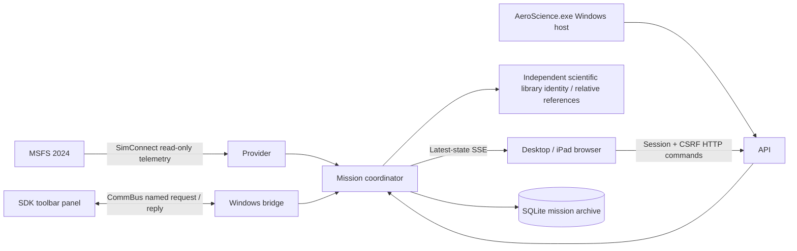

# Architecture and data contracts

The engine owns mission state, storage, recording and provider lifecycles. Closing a display does not affect them.

- `AeroScience.Shared`: wire models, provenance, operating modes and modular instrument definitions, configuration, quality and research contracts.
- `AeroScience.Telemetry`: independent provider interface; generated providers exist only in test projects.
- `AeroScience.SimConnect`: native x64 API bindings, read-only simulator telemetry, and bounded CommBus transport.
- `AeroScience.Missions`: SQLite schema, transactions, recovery, serialized mission transitions, and shared toolbar command handling.
- `AeroScience.Engine`: reusable ASP.NET Core host, security, workers, API/SSE, exports, desktop actions and static browser assets.
- `AeroScience.Desktop`: single WinForms entry point, status, settings, setup, native folder dialogs and feedback.
- `tests/AeroScience.TestHost`: isolated provider injection for deterministic tests; never published.

The native provider requests one observation per second. GUI recording intervals are 1000–60000 ms; lower developer/test intervals do not increase native reception. The stable sampling schedule allows bounded delivery jitter (10%, capped at 100 ms), preserves true received UTC timestamps and never creates/interpolates frames. Snapshot diagnostics separate target, received/skipped/committed counts, sample cadence, mission-wide average, initial delay and missing intervals. See [sampling findings](alpha-testing.md#sampling-investigation).

Position is WGS 84 degrees, altitude feet, airspeed knots, vertical speed feet/minute, heading/track true north. Nullable Mach is requested directly as `AIRSPEED MACH` / `mach`, not derived from IAS. The packed client payload is 360 bytes with Mach at offset 352; the SDK message data offset remains 40. Invalid/missing Mach does not invalidate other fields.
The coordinator serializes display commands and telemetry updates. SQLite WAL and FULL synchronous transactions retain committed samples on interruption. An OS file lock establishes one owner **before** recovery. Restart marks unfinished missions interrupted, ending them at the last committed sample (or their start if empty), without fabricating data across the gap. A disconnect leaves a mission active, logs an event and records no stale frames until telemetry returns. Aircraft changes are events; the initial aircraft identity stays in the mission, while each sample retains the current identity.

## Schema and modes

`PRAGMA user_version=4`. Schema 1 is the initial recording schema; migration 1 → 2 transactionally adds `missions.mode TEXT NOT NULL DEFAULT 'Universal'`. Schema 2 → 3 adds `dataset_references` with dataset/library GUIDs and relative paths. Schema 3 → 4 adds saved research plans, immutable mission context, markers, notes and dataset availability. Existing schema 1/2/3 databases receive verified SQLite backups before modification. Fresh databases run all steps. Existing/incomplete missions keep their IDs/data and default to Universal. Unknown stored mode values read as Universal; a newer schema is refused rather than overwritten.

Missions contain IDs, names, mode, initial aircraft/source, UTC start/end, status, departure/last positions. Indexed telemetry stores a complete typed JSON frame and queryable position/altitude fields. Events carry UTC timestamps and kinds. Instrument-metadata/observation tables allow future instrument IDs, provenance and payloads without replacing the telemetry timeline. `InstrumentMissionContext` supplies the mission mode to future modules. Basic actual atmospheric acquisition uses the independent Science Library; advanced calibration/modeling remains deferred.

Both modes accept any compatible aircraft. Universal simplifies future restrictions; Realistic will eventually evaluate the configured instrument's operating envelope and report warnings/quality, with fallback choices for unknown configurations. It is not a fixed aircraft whitelist. In 0.2.0 the modes have identical recording/acquisition behavior and are immutable for a given mission.

## Storage and offline startup

The Windows host always starts local history/dashboard services regardless of simulator availability. Production has no generated provider; unavailable MSFS produces waiting/retry state, not invented data. Archive access/export is independent of live telemetry. Selected missing databases are never recreated by reads.

Preferences remain at the fixed local app-data root and independently select mission and scientific-library locations. Migration obtains exclusive leases after the host atomically blocks new missions and stops services. SQLite backup, integrity/FK/logical-content verification, library hashes, a persistent journal and atomic settings replacement retain originals and permit recovery. Existing destinations require an explicit separate-store choice, never automatic merging. Stable library IDs and relative dataset paths survive library moves. No instruments/products are generated. See [storage workflow](alpha-testing.md#migration-and-recovery).

## Local API

The server binds to 127.0.0.1:5080 by default. `GET /api/health` returns minimal liveness/version only. `GET /api/access` reports whether the caller needs pairing. `POST /api/session` accepts JSON `{ "code": "..." }`; local loopback may omit the code. It issues an HttpOnly, SameSite=Strict cookie and returns a CSRF token. Sessions expire in 12 hours and on restart. Pairing is rate limited for remote clients; codes are visible only on an authenticated localhost Settings page.

All POSTs require an exact same Origin and JSON content type; mission POSTs additionally require the session and `X-AeroScience-CSRF`. Host validation rejects unrecognized hostnames. No CORS relaxation, proxy headers, external account, or external telemetry service is used. Optional private-LAN HTTP does not encrypt traffic and is only suitable for trusted networks.

| Route | Behavior |
| --- | --- |
| `GET /api/state` | Connection, telemetry, active mission (including mode), sampling interval |
| `GET /api/events` | SSE `state` events, latest state every second; no per-client backlog |
| `POST /api/missions` | `{ "name": "Survey", "mode": "universal" }`; 201, or 400/409 |
| `POST /api/missions/{id}/end` | JSON `{}`; only ends the specified active mission |
| `GET /api/missions?limit=50&offset=0` | Newest first, capped at 100 per page |
| `GET /api/missions/{id}` | Metadata, mode, summary and first 1,000 events |
| `GET /api/missions/{id}/telemetry?limit=1000&offset=0` | Sequence-ordered frames; capped at 5,000 per page |
| `GET /api/missions/{id}/export` | Complete, streamed JSON for completed/interrupted missions; all metadata/events/samples/references |
| `POST /api/desktop/{action}` | Authenticated loopback-only native settings/storage/feedback UI requests |
| `GET /api/settings` | Configuration/diagnostics; sensitive pairing code and local paths limited to loopback |

Wire enums are camelCase strings: `universal`, `realistic`, `recording`, `completed`, `interrupted`, `simulated`, `simulator`. Omitted creation mode defaults to Universal. Unknown request modes are rejected. Paging permits future replay consumers to retrieve a full mission incrementally; no interactive replay is claimed.

The toolbar uses a separate simulator-native local trust boundary. Installed simulator add-ons are trusted operators; CommBus is not an internet authentication system. It cannot change LAN settings, access files or invoke arbitrary engine methods. Commands are versioned JSON with request GUIDs; mutating replies are cached (128 entries) to avoid duplicate transitions on retries. This is bounded in-memory retry protection, not a durable exactly-once guarantee across engine restarts. The coordinator independently enforces one active mission.

## v0.2.0 research extension

`ResearchOperations` executes under the existing coordinator gate. Independent atmosphere/guidance provider updates do not count as flight samples. `ResearchStore` extends the mission store with schema-4 plans/snapshots/markers/notes/diagnostics and bounded geographic queries. `ScienceStore` owns the independent library SQLite database, stable identities, source rows and capacity protection; science errors are isolated from flight acquisition. `ScienceCatalog` defines four modular instruments and editable mission templates. `ResearchExports` streams complete records without display limits.

The dashboard modules `research.js` and `map.js` extend existing navigation/state/API flows; they do not own recording. The native toolbar uses the same coordinator for instrument and marker commands with bounded idempotent CommBus replies. Read-only guidance travels in the shared state and recorded flight frames. No SDK write/control API is introduced. Native `DataManagementForm` runs under stopped-service maintenance and exclusive leases; there is no destructive browser API. See [science operations](science-operations.md).

## v0.2.2 geographic integration

`MissionPlan`/`ResearchWaypoint` remain authoritative. Optional flight rules/cruising altitude, waypoint IDs and explicitly entered published navigation identifiers are JSON-compatible additions; mission DB schema stays 5. Generated vertices have deterministic pattern-based IDs; legacy missing IDs acquire stable IDs when validated/saved. Export preview is read-only and never saves a draft or edits a recording snapshot. `RouteExports` generates current EFB PLN and planned GPX/KML/CSV/clipboard products with one ordered route, canonical WGS84 coordinates and explicit missing-altitude semantics.

`MapSettings` stores separate stable configuration with CurrentUser Windows DPAPI for the public Esri client key. The authenticated loopback configuration routes accept only the supported provider/layers and require the existing origin/CSRF protections. Authorized paired browsers may select already-enabled layers and receive public client tile URLs; no privileged server-credential feature exists. Fixed official provider hosts and disabled redirects constrain metadata discovery. Default/offline preferences cause no provider requests. A small non-secret map-settings revision travels in existing SSE snapshots so paired browsers can disable/change layers together. Source attributions/MapServer copyright are required; failures fall back without touching route data or recording. Feedback never copies map configuration, and release validation rejects it.

`RouteMapService` serves immutable active plan snapshots or an idle selected saved plan. Revisions identify geometry; `map-chunk` replies carry bounded pages only on change/reconnect. `map-state` carries bounded recent/incremental track, fresh position/heading and selected-waypoint WGS84 information. Map progress reuses ordered proximity logic from mission analysis but conservatively reports only positions observed while open. Complete historical analysis remains separate. New track display `BreakBefore` flags preserve actual gaps across downsampling, rather than mistaking sparse display vertices for missing observations. Raw telemetry is unchanged. The native map shares geographic helpers/data with browser maps, uses two canvas layers, and keeps the SDK-owned outer window untouched.

The existing local-only Data Management form retains transactional clear/backup/lease mechanisms. Independent radio groups default to permanent deletion without a new backup on every opening. Backup browsing occurs only inside the requested-backup branch; cancellation never becomes no-backup deletion. Typed phrases, the final irreversible warning and recording/maintenance guards remain. Existing backups and unrelated files are outside row-clearing operations.

## v0.3.0 extension

See [v0.3.0 implementation/verification](v0.3.0-completion.md), [remote-sensing operations](remote-sensing/quick-start.md), [storage safety/accounting](remote-sensing/storage.md) and [current Windows release process](v0.3.0-windows-testing.md). Remote processing is a bounded background worker independent of flight recording; copied scientific sources and complete products use stable identities, relative paths and integrity checks. Existing acquisition/flight modes and stopped-store migrations are retained. Historical manual acceptance instructions in older sections do not apply to the default v0.3.0 automatic technical alpha pipeline.

## Automatic scientific-data acquisition (v0.3.0)

`ScientificAccessSettings` stores separately consented local policy. `ScientificPreparationWorker` offers only bounded plan/aircraft cells to `AutomaticScientificData`; neither performs network/format work under the mission coordinator or 1 Hz telemetry gate. A bounded channel and 1–2 preparations pace direct allowlisted public provider requests. `IScientificDataProvider` has working USGS 3DEP and STAC Earth Search/Planetary Computer adapters. NASA CMR discovery is explicitly distinct from supported numerical preparation.

`ScientificRangeStream` validates each partial response/immutable identity and enforces the total wire-payload budget. The managed `ScientificRaster.CopySubset` writes original native-DN, source-aligned GeoTIFF crops with stable boundary ties. The existing importer validates metadata/readers and atomically publishes hash-verified Sources. Work ledgers retain and account for incomplete preparations; verified duplicated preparation files alone are removed after import. Downloaded sources are retained originals, never registered as regenerable cache. No Python/GDAL runtime or central scientific-download service is introduced.

`ScientificSourceSelection` shares date/quality policy with sampling while preserving the advanced manual-source fallback. Readiness is shared through authenticated local APIs and polled only by mounted visible browser views. A late source is usable only on a subsequent fresh acquisition; the recorder never replays missing source intervals as observations. `AutomaticSourceProvenance` retains stable unsigned assets, actual catalog properties/selected bands, requested coverage, native resolution, original observation/publication time, retrieval time and preparation/QA limitations. Source/product JSON additions are backward compatible.
