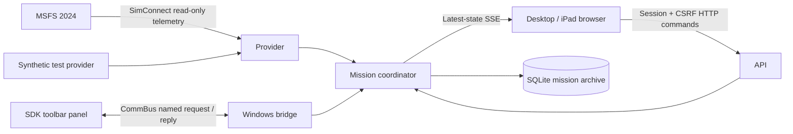

# Architecture and data contracts

The engine owns mission state, storage, recording and provider lifecycles. Closing a display does not affect them.

- `AeroScience.Shared`: wire models, provenance, operating modes and minimal future instrument contracts.
- `AeroScience.Telemetry`: independent provider interface and deterministic synthetic trajectory.
- `AeroScience.SimConnect`: native x64 API bindings, read-only simulator telemetry, and bounded CommBus transport.
- `AeroScience.Missions`: SQLite schema, transactions, recovery, serialized mission transitions, and shared toolbar command handling.
- `AeroScience.Engine`: ASP.NET Core host, security, background workers, latest-state API/SSE and static browser assets.

The provider reads once per second from SimConnect. Recording defaults to 1 Hz and accepts 250–60000 ms configuration; intervals under one second do not increase the native provider's one-second data rate. Synthetic mode follows the configured interval. No data is upsampled or invented to fill simulator gaps. Position is WGS 84 degrees; altitudes are feet, speeds knots, vertical speed feet/minute, headings/track true north. Engine timestamps are UTC wall time for cross-instrument synchronization; a future simulator-time axis may be added independently.

The coordinator serializes display commands and telemetry updates. SQLite WAL and FULL synchronous transactions retain committed samples on interruption. An OS file lock establishes one owner **before** recovery. Restart marks unfinished missions interrupted, ending them at the last committed sample (or their start if empty), without fabricating data across the gap. A disconnect leaves a mission active, logs an event and records no stale frames until telemetry returns. Aircraft changes are events; the initial aircraft identity stays in the mission, while each sample retains the current identity.

## Schema and modes

`PRAGMA user_version=2`. Schema 1 is the initial recording schema; migration 1 → 2 transactionally adds `missions.mode TEXT NOT NULL DEFAULT 'Universal'`. Fresh databases run both steps. Existing/incomplete missions keep their IDs/data and default to Universal. Unknown stored mode values read as Universal; a newer schema is refused rather than overwritten.

Missions contain IDs, names, mode, initial aircraft/source, UTC start/end, status, departure/last positions. Indexed telemetry stores a complete typed JSON frame and queryable position/altitude fields. Events carry UTC timestamps and kinds. Instrument-metadata/observation tables allow future instrument IDs, provenance and payloads without replacing the telemetry timeline. `InstrumentMissionContext` supplies the mission mode to future modules. No advanced instrument behavior is implemented now.

Both modes accept any compatible aircraft. Universal simplifies future restrictions; Realistic will eventually evaluate the configured instrument's operating envelope and report warnings/quality, with fallback choices for unknown configurations. It is not a fixed aircraft whitelist. In 0.1.0 the modes have identical recording behavior and are immutable for a given mission.

## Local API

The server binds to 127.0.0.1:5080 by default. `GET /api/health` returns minimal liveness/version only. `GET /api/access` reports whether the caller needs pairing. `POST /api/session` accepts JSON `{ "code": "..." }`; local loopback may omit the code. It issues an HttpOnly, SameSite=Strict cookie and returns a CSRF token. Sessions expire in 12 hours and on restart. Pairing is rate limited for remote clients; codes are visible only on an authenticated localhost Settings page.

All POSTs require an exact same Origin and JSON content type; mission POSTs additionally require the session and `X-AeroScience-CSRF`. Host validation rejects unrecognized hostnames. No CORS relaxation, proxy headers, external account, or external telemetry service is used. Optional private-LAN HTTP does not encrypt traffic and is only suitable for trusted networks.

| Route | Behavior |
| --- | --- |
| `GET /api/state` | Connection, telemetry, active mission (including mode), sampling interval |
| `GET /api/events` | SSE `state` events, latest state every second; no per-client backlog |
| `POST /api/missions` | `{ "name": "Survey", "mode": "universal" }`; 201, or 400/409 |
| `POST /api/missions/{id}/end` | JSON `{}`; only ends the specified active mission |
| `GET /api/missions?limit=50&offset=0` | Newest first, capped at 100 per page |
| `GET /api/missions/{id}` | Metadata, mode, summary and first 1,000 events |
| `GET /api/missions/{id}/telemetry?limit=1000&offset=0` | Sequence-ordered frames; capped at 5,000 per page |
| `GET /api/settings` | Configuration/diagnostics; sensitive pairing code and local paths limited to loopback |

Wire enums are camelCase strings: `universal`, `realistic`, `recording`, `completed`, `interrupted`, `simulated`, `simulator`. Omitted creation mode defaults to Universal. Unknown request modes are rejected. Paging permits future replay consumers to retrieve a full mission incrementally; no interactive replay is claimed.

The toolbar uses a separate simulator-native local trust boundary. Installed simulator add-ons are trusted operators; CommBus is not an internet authentication system. It cannot change LAN settings, access files or invoke arbitrary engine methods. Commands are versioned JSON with request GUIDs; mutating replies are cached (128 entries) to avoid duplicate transitions on retries. This is bounded in-memory retry protection, not a durable exactly-once guarantee across engine restarts. The coordinator independently enforces one active mission.
