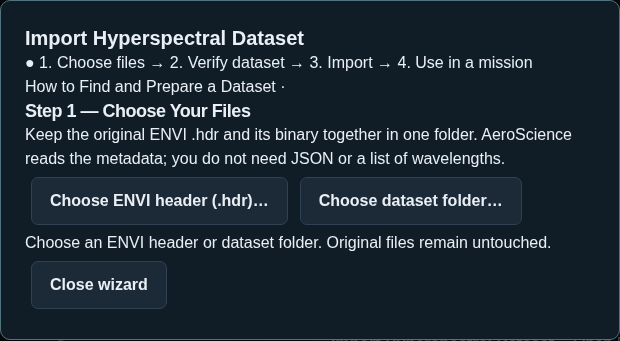
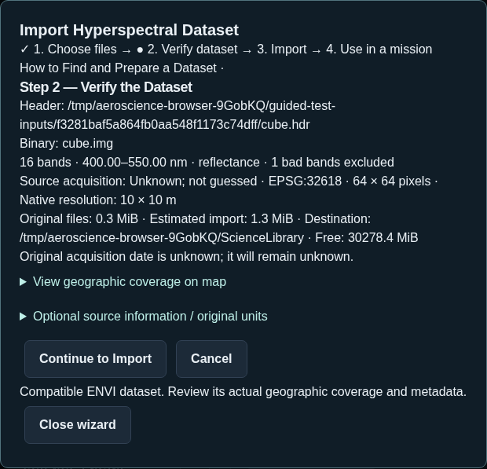
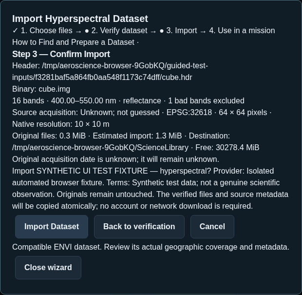
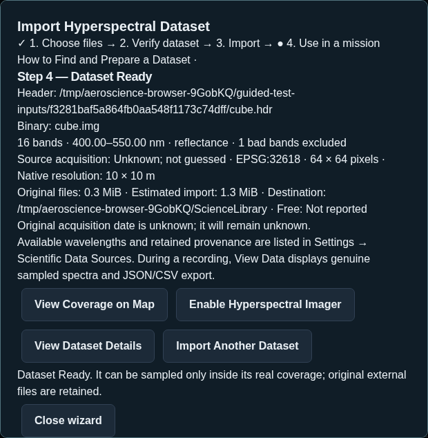

# Using Your Own Hyperspectral Dataset in AeroScience

Hyperspectral data records many adjacent colors, including wavelengths your eyes cannot see. A spectrum can help investigate differences in rocks, vegetation and surfaces. A **dataset** is the original image file plus information telling AeroScience where its pixels belong and what each spectral channel means.

These are historical external Earth observations. Your simulated aircraft selects the geographic footprint to sample; it does not create a new physical measurement. Source observation time, simulated-flight packet time and processing time stay separate. Imported data work offline inside their real coverage.

For official NASA Classic/NG scenes, use the [NASA Hyperspectral Assistant](hyperspectral.md)
inside **Library → Browse & Download Data**. It binds the selected product's metadata to
this same local-file verification/import workflow. NASA handles protected downloads in
your external browser; AeroScience never asks for your password. EMIT stays discovery-only.

## Supported files

Choose an **ENVI `.hdr` header** and keep its original image/binary beside it. The small header describes the larger numeric file, often named `.dat`, `.img`, `.bsq`, `.bil`, or with no extension. Do not choose a photograph, RGB preview or spectral-library-only file.

Supported cubes have 16–512 original channels, distinct positive wavelengths in nanometers or micrometers, supported integer/float values, BSQ/BIL/BIP layout, little- or big-endian storage, and WGS84 geographic or UTM coordinates. North-up and explicitly declared ENVI rotations smaller than 90° are supported by the guided reader. Original values are not resampled. Detector overlaps can reorder the **display list** by wavelength while retaining each original binary channel and bad-band flag.

NetCDF/EMIT, HDF, JP2, unreferenced MATLAB arrays, unsupported coordinate systems and spectral libraries cannot be imported directly. Some AVIRIS/AVIRIS-NG offerings need an account or scientific preparation; they are not all plug-and-play. AeroScience does not require a NASA account or automatic hyperspectral download.

## A real compatible example

NV5 publishes a genuine AVIRIS Cuprite reflectance example:

1. Open [NV5 ENVI Tutorials](https://www.nv5geospatialsoftware.com/Support/Self-Help-Tools/Tutorials). Under tutorial data, choose **Hyperspectral** ([direct ZIP](https://vis-webcontent.s3.amazonaws.com/tutorials/hyperspectral.zip)). Review the provider's usage terms. This download is about **289 MiB**; check your connection and available space.
2. In Windows, right-click the downloaded ZIP and choose **Extract All**. Open the extracted `hyperspectral` folder.
3. Keep **`CupriteReflectance.hdr`** and **`CupriteReflectance.dat`** together. Choose `CupriteReflectance.hdr` in AeroScience. The binary is about **134 MiB** and contains 224 channels at a native 15.5 m grid spacing. Its declared 10° rotation is read directly. No QGIS, Python, conversion or JSON editing is needed.
4. The header supplies reflectance scaling, wavelengths, coordinates and 54 bad-band flags. The original acquisition date is not reliably stated, so AeroScience leaves it **Unknown**. A processing/mosaic date is not substituted for acquisition time.
5. Review the original [NV5 tutorial](https://www.nv5geospatialsoftware.com/docs/HyperspectralAnalysisTutorial.html) for scientific context. The software does not bundle these source files or claim ownership of them.

The genuine source was downloaded and validated through AeroScience's importer and scientific-product pipeline. An independent GDAL comparison matched the rotated affine grid and all 170 usable spectral values exactly. That is data/software validation using a synthetic aircraft position, **not a Windows/MSFS flight test**. See the v0.3.1 completion report for current evidence.

Other legitimate starting points include [NASA AVIRIS](https://aviris.jpl.nasa.gov/data/free_data.html), [AVIRIS-NG](https://avirisng.jpl.nasa.gov/dataportal/) and [NASA Earthdata Search](https://search.earthdata.nasa.gov/). Check format, coordinates, size and access terms before downloading. An `EMIT .nc` file or an unreferenced Indian Pines `.mat` benchmark needs a different workflow; neither is advertised as a directly compatible ENVI example.

## Step 1 — Choose Your Files

Open **Settings → Scientific Data Sources → Hyperspectral Imaging → Import Hyperspectral Dataset**. The same action is available from the Hyperspectral Imager's **Dataset Required** card and Science Collection.

Choose **ENVI header (.hdr)** or **dataset folder**. AeroScience locates the binary using the header and matching original filenames. If several binaries match, select the correct one. If a folder contains several headers, choose the particular `.hdr` instead.

## Step 2 — Verify the Dataset

Review the band count, wavelength range, original scientific units, coordinate system, geographic envelope, native grid, bad-band information, source date, file size, destination and free space. Expand **View geographic coverage on map**, then pan/zoom to understand where you can use the dataset.

If the source does not identify its units, choose **only the units stated by its documentation**. Radiance is never automatically changed into reflectance. Optional friendly name, provider, source link, known date, usage terms and notes are kept as user-entered information, separate from header-derived fields. Leave unknown information unknown.

## Step 3 — Import

Choose **Continue to Import**, review the source, destination, space requirement and limitations, then **Import Dataset**. AeroScience generates its internal metadata automatically, validates the originals, copies them into the Scientific Data Library, verifies their hashes and publishes the source atomically. Your external originals remain untouched. Exact duplicate imports reuse the existing verified source.

Cancel stops the operation. Interrupted staging is never advertised as ready and remains available for explicit review in Storage Management. Insufficient space or an unavailable external drive produces an error rather than an empty replacement library.

## Step 4 — Use in a Mission

**Dataset Ready** means a compatible retained source is available. Choose **View Coverage on Map**, **Enable Hyperspectral Imager**, **View Dataset Details**, or **Import Another Dataset**. Readiness checks also work with scientific online access disabled.

Start a research recording, fly within the dataset's geographic coverage and keep a valid simulator AGL/attitude. In **Science Collection → Remote-Sensing Products**, select **Hyperspectral Imager → View Data** to inspect the spectrum and source metadata, and export JSON/CSV. Bad bands and nodata remain missing rather than fabricated. No observation is produced outside coverage or when acquisition conditions are invalid; the reason remains visible and flight telemetry continues.

All four screenshots show the implemented browser wizard with explicitly **synthetic UI test data**. They are interface examples, not the genuine Cuprite data or Windows hardware acceptance.

## Common problems

| Status/problem | What to do |
| --- | --- |
| Dataset Required | Import a compatible ENVI cube for your research area. |
| Dataset Outside Coverage | View Coverage, fly inside it, or import another genuine dataset. |
| Dataset Invalid | Keep the matching original header and binary together; review the precise reported error and reimport verified originals. |
| Binary missing/ambiguous | Extract the archive fully; choose the correct header or associated binary. Do not rename an unrelated image to make it fit. |
| Missing wavelengths or geographic coordinates | Obtain a properly documented/georeferenced product from its provider. AeroScience does not guess them. |
| Unsupported CRS/format | Select an already compatible source. Expert conversion is separate from this beginner workflow. |
| Low space | Open **Settings → Storage & Data** and select available capacity or change the Science Library safely. |
| Acquisition Unavailable | Check actual location, footprint, AGL, attitude, bad bands/nodata and source quality; wait for a subsequent valid packet. Earlier missing intervals are never backfilled. |

[Scientific Data Sources](scientific-data-sources.md) · [Quick start](quick-start.md) · [Advanced manual manifest reference](sources.md) · [Exports](exports.md)
