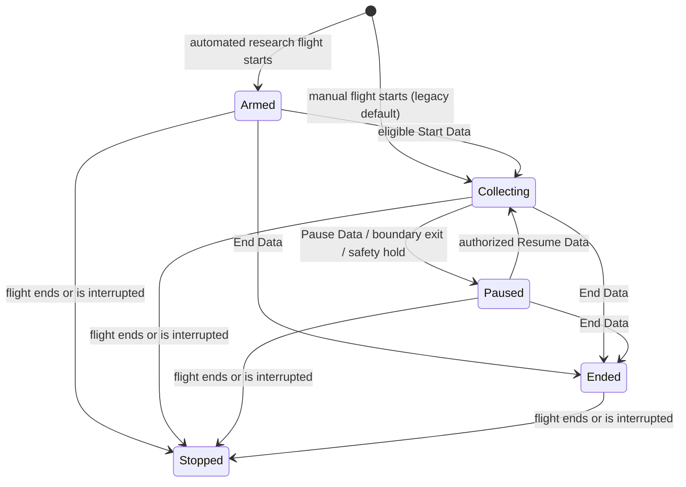

# v0.5.0 technical architecture and implementation strategy

**Design proposal, not implemented.** Source inspected: v0.4.2
`8f510f02f4d9b41fba4e55fefa950b82e48c132d`, 2026-10-20. Requirements are in
[scope](v0.5.0-scope.md); test obligations and unresolved research are in
[acceptance](v0.5.0-acceptance.md) and [decisions](v0.5.0-decisions.md).
Names/fields below are proposed contracts, not newly available APIs or classes.

## Existing implementation and extension points

Paths below are relative to the repository root; no parallel storage, math or acquisition stack is proposed.

| Current source | Implemented behavior / limitation | Proposed extension |
|---|---|---|
| [Shared models](../../src/AeroScience.Shared/ResearchModels.cs), [science models](../../src/AeroScience.Shared/MissionScienceModels.cs) | Universal/Realistic, optional plans, instrument settings, versioned payload/profile, source provenance and pause status | Add optional versioned policy/calibration/collection/rubric snapshots; retain enum semantics and legacy defaults |
| [MissionCoordinator](../../src/AeroScience.Missions/MissionCoordinator.cs) | One mutation gate for telemetry and all client commands; flight recording slots, immutable start context, maintenance protection | Own collection authority and committed decisions. `Apply` currently calls `ResearchOperations.Observe` **before** flight append/duplicate-slot handling; make the evidence/decision ordering explicit before enabling automation |
| [ResearchOperations](../../src/AeroScience.Missions/ResearchOperations.cs) | Per-instrument cadence, actual atmosphere values, configuration events, intentional pause, remote dispatch | Consume authoritative collection decisions and operating assessments; keep existing cadence/gap rules. `Begin` currently unpauses; `End` clears mission context, so neither alone represents Armed/Ended-science-with-flight-active |
| [InstrumentProfiles](../../src/AeroScience.Missions/InstrumentProfiles.cs) | Validated versioned reference/custom optical/scanner profiles, freeze, mount, spacing/GSD/rate planning, some temperature metadata | Calibration and typed evidence-backed operating rules, including atmospheric instruments; no new instrument hierarchy |
| [ScienceCatalog](../../src/AeroScience.Missions/ScienceCatalog.cs) | Eight instruments, six templates, 1–60 s acquisition intervals, plan validation and stable waypoint IDs | Per-instrument assessment capability declarations and template/rubric applicability. This is the instrument catalog, not a remote scene catalog |
| [RemoteAcquisition](../../src/AeroScience.Missions/RemoteAcquisition.cs), [SensorGeometry](../../src/AeroScience.Missions/SensorGeometry.cs), [TerrainPlanning](../../src/AeroScience.Missions/TerrainPlanning.cs) | Bounded per-instrument workers, generation invalidation, genuine source selection/QA, mounted footprint and optional terrain planning | Attach assessment/configuration/collection evidence IDs; keep invalid geometry out of derived results while preserving inputs |
| [MissionAnalysis](../../src/AeroScience.Missions/MissionAnalysis.cs), [TransectPasses](../../src/AeroScience.Missions/TransectPasses.cs) | Ordered observed waypoint proximity, geodesic route deviations, gaps and repeated-pass analysis; explicitly no pilot score | Reuse helpers and complete archived evidence for grading; route adherence is not scientific area coverage |
| [ScientificCoverage](../../src/AeroScience.Missions/ScientificCoverage.cs), [ScientificWorkspace](../../src/AeroScience.Missions/ScientificWorkspace.cs) | QA-valid native-pixel support union distinct from modeled footprint area; regional bounds, source identities and offline review | Reuse for eligible yield/coverage criteria and review; no coarse display-based scoring |
| [RouteMapService](../../src/AeroScience.Missions/RouteMapService.cs) | Route cache/chunks; `nextWaypoint` advances inside `State` when the map is polled, using a 1,000 m proximity test | **Never use map polling as the trigger clock.** New backend progress/evidence can be projected into this display later |
| [AutomaticScientificData](../../src/AeroScience.Missions/AutomaticScientificData.cs), [ScientificProviders](../../src/AeroScience.Missions/ScientificProviders.cs) | Shared provider queue, local reuse, bounded numeric subsets; discovery chooses one acceptable scene from up to 60 candidates | Add explicit catalog browsing/scene selection and durable Library job intents to these services, not a second downloader |
| [ScientificHttp](../../src/AeroScience.Missions/ScientificHttp.cs), [ScientificTransferLedger](../../src/AeroScience.Missions/ScientificTransferLedger.cs) | Trusted URLs, retries/Retry-After, validated partial reads, bounded in-memory metadata/range caches and transfer reservations | Source-identity-aware resume and explicit job budgets; persist required commitments, not tokens/signed URLs |
| [ScientificPreparationWorker](../../src/AeroScience.Engine/ScientificPreparationWorker.cs) | Progressive route/survey cells, explicit saved preparation sessions, per-instrument summaries, flight priority | Extract reusable session orchestration for Library intents while retaining old session compatibility. Automatic queue dictionaries alone are not a durable Library queue |
| [AutomaticScientificData NASA search](../../src/AeroScience.Missions/AutomaticScientificData.cs), [guided import](../../src/AeroScience.Missions/GuidedScientificImport.cs), [ENVI import](../../src/AeroScience.Missions/HyperspectralImport.cs) | CMR metadata only, two granules per each of three configured collections; discovery DTO lacks actual footprint/asset identity. Local compatible ENVI import is implemented | Add real paged granule/footprint/link contracts and per-product authorized AVIRIS assistance; reuse importer, keep EMIT decoding deferred |
| [MissionStore](../../src/AeroScience.Missions/MissionStore.cs), [ResearchStore](../../src/AeroScience.Missions/ResearchStore.cs), [ScienceStore](../../src/AeroScience.Missions/ScienceStore.cs) | Mission schema **7**, Science Library schema **2**; raw JSON, independent stores, verified backups, library IDs | Additive versioned evidence/state/job tables in these stores; no rewrite of old samples or observations |
| [ScientificDownlink](../../src/AeroScience.Missions/ScientificDownlink.cs), [ManagedScientificWork](../../src/AeroScience.Missions/ManagedScientificWork.cs) | Durable eligible recovery evidence and owned partial-artifact ledgers; not a generic all-purpose acquisition journal | Reuse exact-packet recovery and staging ownership; add collection eligibility to new evidence and keep reconstructed products labeled postflight |
| [StorageManager](../../src/AeroScience.Missions/StorageManager.cs), [StorageManagement](../../src/AeroScience.Missions/StorageManagement.cs), [ScientificCache](../../src/AeroScience.Missions/ScientificCache.cs) | Independent locations, leases, safe backup/migration, caps/reservations and protected originals | Account for new evidence/jobs and protect source dependencies; no automatic deletion of scientific originals |
| [ResearchApi](../../src/AeroScience.Engine/ResearchApi.cs), [AccessControl](../../src/AeroScience.Engine/AccessControl.cs) | Shared authenticated browser routes, paired clients, origin/CSRF and loopback-only sensitive actions | Add read models and bounded commands using the same protections |
| [Browser planner](../../src/AeroScience.Engine/wwwroot/research.js), [Library](../../src/AeroScience.Engine/wwwroot/scientific-library.js), [workspace](../../src/AeroScience.Engine/wwwroot/science-workspace.js) | Vanilla shared workstation UI, retained-source map, separate preparation and review | Extend current pages with readiness, triggers, catalog browsing and intelligence; no UI framework/navigation rewrite |
| [ToolbarCommandHandler](../../src/AeroScience.Missions/ToolbarCommandHandler.cs), [native panel](../../msfs-toolbar/PackageSources/html_ui/InGamePanels/AeroScience/AeroScience.js) | Shared coordinator; protocol 1, commands ≤1,024 characters, replies ≤8,000 UTF-8 bytes, map chunk target 6,200 bytes; 128-request in-memory dedupe | Small revisioned intelligence projection and explicit science controls; durable collection-command identity belongs in backend, not this cache |
| [Approved branding](../../assets/branding/README.md), current web/toolbar SVGs, Desktop project and installer | Approved primary/toolbar vectors are references only; live icons remain legacy, web manifest lists only SVG, Desktop has no custom ICO, installer uses default Setup artwork | UX-02 uses faithful derivatives and existing resource paths; source audit/targets and SDK rendering limits are in the [branding strategy](v0.5.0-branding.md). No mission/API/schema change |

The required [completion report](../v0.4.2-completion.md),
[profiles](../v0.4.0-instrument-profiles.md), [methods](../v0.4.0-scientific-methods.md),
[replay/coverage](../v0.4.0-replay-and-coverage.md) and [operations guide](../science-operations.md)
were reviewed. Older guide sections describe schema 5 and pre-remote features; current
source/schema/versioned artifacts govern implementation. Preserve those historical documents.

## Ownership and proposed contracts

Keep pure policy/evaluation logic in `AeroScience.Missions`, transport-neutral DTOs in
`AeroScience.Shared`, and hosted scheduling/auth/native actions in `AeroScience.Engine`.
New class names describe responsibilities; avoid an independent service per small rule.

| Proposed model / owner | Essential fields and invariants |
|---|---|
| `CalibrationDefinition` / extend profile settings | Immutable ID/revision/hash, instrument/channel applicability, parameter/value/unit, reference revision/URI, origin (documented/user-defined), author/date where supplied, validity conditions, status and limitations. Unknown/unverified is explicit; no default certificate/accuracy |
| `EffectiveInstrumentConfiguration` / existing configuration timeline | Existing instrument/interval/payload plus optional calibration snapshot and operating-policy ID/version/hash. Freeze complete effective content at start and each configuration event; do not resolve an old mission through today's mutable catalog |
| `OperatingAssessment` / pure `InstrumentOperatingAssessment` evaluator | Mission/instrument/config revision, input receipt IDs/times, rule/version, observed parameter/unit, documented constraint/basis, outcome, reasons and affected derivations. Separate `derivationValidity` from advisory `operatingCompliance` and source/observation quality |
| `CollectionPlan` / optional `MissionPlan` extension | Version, initial Manual or Armed policy, bounded trigger list, boundary policy, continuity/hysteresis policy, authority defaults; no automation for legacy plans |
| `CollectionTrigger` | Stable ID, action Start/Pause/Resume/End, kind point/directional gate/area entry/exit, stable waypoint/area reference, route occurrence/pass, tolerances/direction, once-per-occurrence key, applicability and explicit initial-inside policy |
| `CollectionState` / `MissionCoordinator` | Phase, control authority, manual hold, safety/continuity hold, last transition sequence, current plan/config revision, fired/suppressed occurrence keys and last eligible position receipt. Instrument availability does not masquerade as phase |
| `CollectionEvent` / partial `MissionStore` | Unique mission sequence, command/trigger occurrence ID, from/to/authority, reason/outcome, UTC and source times, input/evidence refs or exact bracketing packets, rules/config hashes. Record manual, suppressed, no-op/conflict and safety transitions without flooding identical updates |
| `MissionAssessmentContext` | Frozen template/objectives, expected work/collection windows, effective settings timeline, rubric/version/hash, applicability, grade thresholds and continuity limits. Post-start edits cannot erase initial obligations |
| `ReadinessAssessment` | Draft/saved-plan content hash, settings/source/storage revisions, assessed UTC, per-check Ready/Caution/Unavailable/Not Yet Assessed, evidence/actions and expiry/staleness. Never creates downloads or starts collection |
| `MissionGrade` / pure evaluator plus background projection | Rubric and evidence manifest hashes, input cutoff/revision, category/criterion results, applicability/missing reasons, denominators, score/grade eligibility, provisional/final/revised status, recommendation codes. No accuracy label |
| `ScienceYield` | Per-instrument actual acquisition/measurement support, valid versus assessed counts, expected obligations/completeness, valid geographic union with method/source dates, live versus reconstructed origin. Separate from `MissionGrade` |
| `CatalogSearch` / extend provider adapters | Bounded geometry, provider/product/date/QA/band choices, cursor/work cap; return actual scene IDs/revisions/footprints, known metadata, authoritative links and supported actions; Unknown stays unknown |
| `LibraryAcquisitionPlan` / shared preparation orchestration | Selected scene/assets/band recipe, normalized bounded work units, local-reuse map, estimates/bounds/unknowns, consent/settings revisions, approval hash/expiry, stable job/item IDs and commitments. An exact scene selection must not silently fall back to another scene |

Keep WGS84 coordinates, meters for horizontal geometry, canonical feet for existing MSL
targets, true headings and explicit speed types. Reuse Aviation/Metric conversion only at
the UI boundary. Add stable survey-area IDs when a plan is explicitly saved; old plans
without them remain readable, with no trigger references invented during replay.

## Instrument and calibration evaluation

- Extend `InstrumentProfiles` and `ScienceCatalog` with capabilities and typed referenced
  constraints. Manufacturer examples conditional on reflectance/PRR are not universal
  range limits. A generic/unknown aircraft or payload gives relevant Unknown/Caution,
  never a whitelist rejection.
- Raw simulator values and original scaled/QA-filtered external values remain authoritative.
  Optional user calibration produces a separately identified derived channel with formula,
  parameter revision, original-value linkage, units and applicability. Default processing is
  unchanged; a modeled camera profile does not recalibrate a satellite scene.
- Reuse `SensorGeometry`, source capability checks and actual cadence to assess geometric
  validity and intended overlap. An impossible ground ray withholds its footprint/product;
  a speed/overlap advisory does not remove valid temperature or reflectance originals.
- Distinguish missing environmental evidence from exceeding a documented limit. Ambient
  temperature is not payload internal temperature without a defensible documented proxy.
  Local weather cannot overwrite historical satellite cloud/QA masks.

## Collection state machine and authority

Flight state (`Recording`/`Completed`/`Interrupted`) stays independent of collection:

`Ended` is terminal for science in that flight. `Stopped` denotes no active flight;
quality/availability of each instrument is reported separately. An Armed mission may
also carry a manual hold before first Start; no fabricated acquisition is created.

| Input | Decision |
|---|---|
| Manual Start/Resume in Armed/Paused | Explicit command selects manual authority and releases manual hold; overrides automatic actions until the user explicitly rearms automatic control. Safety/invalid-input holds remain visible |
| Manual Pause | Sticky manual hold, no automatic Start/Resume may clear it; record authority/reason and retain flight recording |
| Return to automatic control | Explicit audited rearm, evaluate from fresh baseline/current membership; never replay missed crossings retroactively |
| Eligible automatic Start/Resume | Only in automatic authority, legal prior phase, fresh continuous evidence, and no manual/safety hold |
| Area exit/entry | Boundary pause/resume only when enabled and authorized; use hysteresis. Resuming a boundary pause cannot clear manual or route holds |
| Manual or eligible automatic End | Enter Ended, invalidate future queued acquisition generation, retain completed products; duplicate End is an auditable idempotent no-op. All subsequent Start/Resume commands are refused for this flight |
| Same-time conflicting automatic actions | Frozen deterministic order: End dominates Pause, Pause dominates Resume/Start; tie-break by plan occurrence order/trigger ID. Manual sequence/authority wins over automatic resume |
| Flight End/engine interruption | Record terminal event, close exposure intervals, invalidate acquisition work and preserve committed evidence; no restart into Collecting |

Existing pause/resume endpoints and toolbar ops delegate to the new controller. In
legacy manual missions their behavior stays the same. On an automated mission a manual
pause is explicitly shown as an override. Existing consumers receive a compatible
`ResearchState.CollectionStatus` projection plus optional richer fields; do not rename
old enum strings or treat Armed/Ended as collecting.

### Trigger evaluation and recorded inputs

1. Run from `MissionCoordinator.Apply`, never `RouteMapService.State`, DOM timers or a
   client connection. Classify fresh unique positions separately from independently timed
   atmospheric packets; only eligible position evidence advances geographic triggers.
2. Reuse `Geodesy`, `SurveyGeometry`, ordered-route and transect helpers. Point triggers
   require observed proximity; directional crossing gates require continuous bracketing
   positions, direction and the configured route occurrence. Do not infer an unobserved
   point visit. Same coordinates on different passes retain different occurrence keys.
3. Bound continuity with a frozen maximum gap, position freshness, physically plausible
   displacement relative to measured speed/elapsed time and known simulator pause/slew
   indicators where available. No universal aircraft-speed cap. A jump, reconnect, stale
   position or unsupported geometry resets the crossing baseline and records Unknown;
   it cannot fire a series of skipped triggers. Use a conservative visible safety hold
   and explicit rearm after a disrupted automated sequence.
4. Boundary membership uses documented spatial/temporal hysteresis. At initial/rearmed
   inside position, default entry policy requires a witnessed entry; an explicit
   `startWhenInitiallyInside` option may start on a fresh inside receipt labeled as such,
   never as a witnessed boundary crossing. Grazing/tangency and unsupported polar geometry
   give no inferred crossing. Split dateline bounds and test topology; reject unsupported
   automation geometry with manual fallback rather than alter saved coordinates.
5. Persist the transition and once-only occurrence key atomically before dispatching
   acquisition. Failed persistence cannot leave an unaudited collecting state. A transition
   failure holds automated science with a clear warning; flight recording continues if
   its own store remains writable. Flight-store failure retains existing safe interruption.

### Ingress, transactions and asynchronous acquisition

The current pre-append `Observe` call requires a focused integration change, not a
replacement coordinator. For an eligible ingress item, compute pure decisions, then
commit the applicable flight row, controller checkpoint/events and acquisition intent
through one `MissionStore` transaction before applying that decision to `ResearchOperations`.
Independent atmosphere arrivals keep their own cadence/timestamps; an atmosphere-only
update cannot advance a route trigger.

Flight recording may intentionally sample less often than incoming positions. Evidence
for a transition must therefore reference a committed telemetry row **or retain its exact
input/bracketing packets** in the mission evidence ledger; never invent a foreign sample
ID or silently increase the user's flight recording rate. Persist failed/unavailable
required acquisition opportunities and configuration revisions as well as successes.

Reuse the existing bounded remote worker/generation checks. No provider call, raster
read, archive scan, coverage union or grading pass runs under the coordinator gate.
Use a small transactional outbox/intent identity `(mission, instrument, slot, config,
collection epoch)` for cross-store handoff. The worker publishes a verified Science
Library result idempotently and acknowledges that intent. The two existing SQLite
stores are not one transaction: reconcile crash windows by stable IDs and hashes.
Reconstructed pending work remains labeled postflight; it is never credited as live
collection during Armed/Paused/Ended intervals or absent evidence.

## Readiness, grading and yield

`PreflightReadiness` combines the current plan validator, sensor assistant, source
capabilities/readiness and storage estimates with new policy/trigger/rubric checks.
It can assess an unsaved draft by content hash. Save does not require Ready; assessment
does not fetch data. Source search/preparation needs the existing separate consent and
explicit acquisition workflow. Expired source/capacity assumptions are displayed as stale.

`MissionGrading` is a pure deterministic evaluator over frozen settings, complete stored
evidence and versioned rubric rules. The live view is a bounded incremental projection;
the final job replays the complete archive, not map/display-thinned samples. Rubric v1
proposes the requested 20/30/25/25 category weights and A ≥90, B ≥80, C ≥70, D ≥60,
F <60. Freeze thresholds and applicability at mission start; treat these as pilot
performance policy, not measurement accuracy or an established instrument standard.

- Predeclared inapplicable criteria can be excluded and their weights normalized with
  an explicit breakdown. Do not dynamically drop difficult, failed or missing criteria
  during flight. For unknown outcomes show a score interval/provisional status; do not
  silently assign perfect/zero compliance. Proposed eligibility requires ≥80% of frozen
  applicable criterion weight evidenced and all mission-required evidence classes; otherwise
  final status is Insufficient evidence, without an A–F grade. Use frozen total applicable
  weight to report a lower/upper score bound when outcomes are unknown; assign a final
  letter only if the whole remaining range falls in that letter band. Do not normalize
  away missing evidence or quietly count it as either success or observed failure.
- Define expected work by saved route/survey/profile objectives and authorized collection
  windows, not only times the pilot left science enabled. Known omitted required segments,
  unscheduled disabling/ending or selective pauses cannot shrink that denominator. Planned
  transit and documented legitimate/safety pauses are separately classified. Unknown gaps
  reduce evidence sufficiency rather than imply either an ideal flight or observed misconduct.
- Provider outages/cloud masks lower scientific availability/yield, not automatically pilot
  compliance. A readiness/preparation failure may be pilot-actionable only under an explicit
  rubric rule with evidence of an available corrective action. Keep unchanged planned-area
  coverage visible even when no fair pilot penalty is possible.
- Report Good Data among assessed actual opportunities, success among acquired sets,
  expected-work completeness, operating compliance and native valid-area coverage as
  distinct metrics. Count wind's two fields separately from its acquisition set. Each
  metric includes numerator/denominator, units/method, missing/unassessed counts and time scope.
- Use `ScientificCoverage` only where its native support/region limits apply; no survey
  polygon means no survey percentage. Atmospheric profiles use appropriate altitude/time
  obligations instead. Do not broaden the existing ≤100 km coverage solver to serve regional
  download selections. Live coverage is Pending/last-computed when exact work is not ready.
- Postflight downlink may improve separately labeled reconstructed yield/coverage. It cannot
  create flight-time compliance, resolve absent atmospheric values or erase original gaps.
  Store report revisions with evidence cutoffs; never rewrite a previous grade silently.

Recommendations are deterministic rule explanations with linked inputs/actions, not
language-model scientific findings. Universal can show factual yield/readiness/advisories;
Realistic pilot grading follows the frozen mission contract; unsupported legacy flights
are not assigned retroactive grades.

## Persistence, migrations and exports

Propose mission schema **8** and Science Library schema **3**, subject to reserving the
next available versions when implementation starts; these numbers are not applied here.
Keep the current upgrade backup/fingerprint/integrity/foreign-key checks and reject
newer unsupported schemas. Both data roots, WAL-aware migrations, leases, protection,
rollback, missing-drive errors and original retention stay authoritative.

| Existing store | Proposed additive records |
|---|---|
| Mission database | Effective policy/calibration/rubric snapshots; sequenced collection events/checkpoints; unique trigger occurrence/command keys; bounded exact evidence receipts and acquisition intents; operating assessments or lossless interval summaries; immutable grade revisions/input manifests |
| Existing plan/preset JSON | Optional versioned calibration and collection/rubric preferences; stable area IDs only on explicit save; no compulsory backfill or geometry rewrite |
| Science Library SQLite | Durable approved Library job/item intents and verified byte/source identity checkpoints; assessment/intent links to new outputs; source dependency/protection references |
| Existing application settings | User calibration definitions/revisions and permitted catalog preferences through current atomic settings patterns. Mission snapshots retain full needed content, not only mutable settings-file paths |

Retain existing `scientific_recovery`, artifact/source tables and owned-work ledgers;
extend and reconcile them, never treat them as duplicate observations. Unique constraints
make command retry, trigger replay and worker completion idempotent. Checkpoint updates
and their event append share a mission transaction; append-only evidence hashes support
reproduction, not tamper-proof or certified-calibration claims.

Do not attempt cross-database atomic commits. Test kill points before/after each durable
intent, verified product publication and acknowledgement. A missing Library allows flight
history/review with explicit unavailable science, not a new empty replacement library.
On process restart retain `MissionStore.RecoverInterrupted`: active flight is Interrupted;
no automatic continuation of collection or replayed triggers. Same-process reconnect
retains fired keys/manual authority while resetting geographic continuity.

Legacy missing fields mean manual collection, no calibration claim, no new trigger and
Not graded, rather than guessed success. Replay can show existing pause events while
acknowledging missing typed transition evidence. Preserve original JSON/pixel hashes and
old exports. Extend `ResearchExports`, `ResearchPackage`, replay and reports with versioned
collection/assessment/calibration/rubric/yield sections and canonical CSV tables; retain
old fields and CSV-injection protection. Include exact rule/config/source identities and
reconstructed-versus-live labels. Export no credentials or signed URLs. A v0.4.2 binary
must not open a migrated newer archive; downgrade uses a verified preserved backup.

## Geographic Library and NASA acquisition

Extend current provider adapters with a bounded catalog-browser capability; current
`Discover` returns one choice, so it cannot directly satisfy scene browsing/pagination.
Keep one HTTP/validation/budget/acquisition pipeline. Catalog search preserves real scene
footprints, revisions and original observation times; cached results have an as-of/expiry
and cannot be presented as current verified downloads or QA-valid geographic support.

Normalize cells/viewport/polygons/authoritative region selections using existing geometry
and preparation-cell enumeration. Distinguish selected shape, actual subset footprint,
source footprint and sampled mission coverage. Proposed initial job caps: 4,096 work
units and paged scene metadata, reusing the existing 100,000-candidate preparation bound;
these are reviewable workload limits, not claims that a whole state fits. Split dateline
requests and preserve current per-request latitude/extent bounds. Oversized regions need
explicit smaller jobs; no automatic unbounded expansion.

Build an approval preview from a canonical selection hash: scene/date/band recipe, bounded
units, actual retained reuse, known byte bounds versus Unknown, storage/temp reservations,
settings/consent and license. Revalidate before committing. A provider revision or increased
scope/cost beyond approval requires a new preview; do not switch an explicitly chosen scene.
Use native regional reuse/coalesced ranges only where it minimizes bytes and preserves
resolution/QA; never download a huge original simply to reduce HTTP request count.

Generalize `ScientificPlanData`'s durable session orchestration and `AutomaticScientificData`
for approved `library:` intents. Retain compatibility with current saved plan sessions;
do not create fake missions to download sources. Schedule all scopes through the current
queue and extend its flight-priority handling to Library/NASA work explicitly. Journal
job/item intent in the existing Library store and reconstruct pending queue entries from
it after restart; this is new work beyond today's in-memory dictionary. Pause/cancel,
partial staging ownership and verified source publication use current managed-write rules.

Resume bytes only against verified immutable asset/checksum or matching ETag/length with
correct 206/Content-Range behavior. Changed content requires a new safe attempt. Persist
unsigned identity, offsets and verified hashes, never access tokens/signed URLs. A renewed
approval cannot silently reset used budgets or duplicate exact retained sources.

NASA discovery extends the current three-collection CMR search with collection/granule
concept IDs/revisions, normalized actual footprint, pagination, links and truthful format/
spectral/size fields. Collection names/versions must be revalidated at implementation.
Use the same catalog/Library job UX with per-product capabilities. AVIRIS distributions
need genuine format validation before declaring an adapter supported; safe archive
handling rejects traversal, reparse points, missing companions and decompression bombs.

Use an officially supported user-authorized local flow where viable, otherwise a functional
official-browser download handoff and guided verified file selection. Never request a NASA
password in the app or send credentials to an AeroScience server. Extend trusted endpoint
and redirect rules only for researched provider hosts; strip authorization across trust
boundaries, redact logs and use Windows-protected local secrets for any supported token
flow. Imported files pass through `GuidedHyperspectralImport`/existing ENVI validation and
normal atomic source publication. EMIT remains discovery/official-link only, explicitly
not directly importable; no NetCDF reader, package dependency or EMIT sensor claim in v0.5.0.

## APIs, clients and transport compatibility

These are proposed additions to `ResearchApi`, with normal session/pairing/origin/CSRF,
validation, pagination, cancellation and server-enforced resource bounds:

| Proposed surface | Purpose / compatibility |
|---|---|
| `POST /api/plans/readiness`, `GET /api/plans/{id}/readiness` | Explicit draft assessment / saved current assessment; no save/download side effects |
| `GET /api/instruments/{id}/assessment-capabilities`, calibration-definition routes | Supported documented parameters/versions; user edits and credential/native file operations remain loopback-only |
| `POST /api/missions/{id}/collection/control` | Start/Pause/Resume/End/rearm with mission ID, request ID, expected controller revision; stale cross-client commands conflict, duplicates return original outcome |
| Optional intelligence on `/api/state`; paged mission collection/assessment/grade/yield reads | One revisioned backend view across Control, iPad and review; cache/status projection, not heavy analysis per poll |
| `POST /api/science/catalog/search` | Bounded provider metadata browsing, actual cursor and as-of; separate local-coverage reads work offline |
| Library acquisition preview/commit/job-control routes | Hash-bound explicit approval, durable queue and pause/resume/retry/cancel; host consent/budget/security restrictions are not editable by paired clients |
| NASA assistant access/import action | Product-specific supported direct flow or official browser handoff; local file selection/secrets remain native/loopback-only |

Existing HTTP `/api/missions/{id}/science/state` (`paused`) and toolbar `science-pause` /
`science-resume` behavior is adapted, not removed. Client
commands cannot set scores, overwrite raw QA or bypass manual holds. The backend owns
all trigger state even with every display closed.

Extend current Planner, Control, Library, Downloads, Science Map/Compare/Analysis and
Help pages. Put detailed rubric/calibration/source choices in those pages; keep relevant
actions and errors accessible by keyboard/touch and offline review. Online scientific
consent remains independent of basemap consent; catalog queries also reveal geography/IP.

Native Mission/Payload/Map navigation and Compact VR behavior remain. Add short phase,
one relevant advisory/upcoming trigger, provisional score or Unavailable and selected
yield metrics only if they fit. Keep protocol 1 compatible through optional fields and
capability negotiation; legacy clients can still pause/resume. New Start/End controls
must be hidden or refused on an old engine. Retain ≤1,024-character commands and ≤8,000
UTF-8-byte replies (under the transport's 8,192-byte bound), including non-ASCII worst
cases; use a bounded detail request/page rather than silently truncating scientific values.

## UX-02 branding boundary

Branding is a resource/packaging feature independent of calibration, grading, collection
and acquisition services. Follow the [source/consumer/derivative audit](v0.5.0-branding.md):
use approved primary artwork for application surfaces and the approved white-A/black-arc
variant for the registered MSFS toolbar icon. Preserve approved source hashes, resource
identity, transparency, color and aspect ratio; do not redraw or create missing Discord art.

The future `feature/v0.5.0-branding` PR may proceed after architecture review alongside
scientific work. Coordinate Help/project manifests with DOC-01 and shared native/CSS
files with UX-01. Add deterministic source-to-PNG/ICO provenance and build/reference tests;
derive resources before normal receipt/hash creation. Preserve the installer AppId,
shortcuts, native panel ID/icon registration, accessibility labels and read-only simulator
boundary. Current public SDK listener documentation does not establish a fixed icon-size
list: confirm installed SDK format/samples and actual MSFS rendering separately. No active
branding replacement, icon derivative deliverable or platform rendering pass occurs here.

## Performance, offline and failure boundaries

- Proposed automatic plan cap: 128 trigger occurrences, within existing 1,000-waypoint,
  20-area/1,000-vertex validation limits; precompute candidate bounds outside the live gate.
  Evaluate only bounded local geometry per fresh position. Measure critical-path latency
  and 1 Hz cadence against the unchanged baseline; do not claim an unmeasured latency gain.
- Provisional grade updates use incremental evidence summaries; full analysis/export runs
  in bounded cancellable background work. Reuse existing analysis limits and report Pending/
  Unsupported rather than computing partial percentages as complete.
- Preflight, triggers, grading and archive review operate offline using frozen definitions
  and available local sources. Provider search/download requires consent/network. Missing
  external drives, denied permissions, low space, provider outages and authentication expiry
  remain visible recoverable states; they do not fabricate data or change raw QA.
- Preserve 25 GB mission / 50 GB Library defaults, configurable policies and 64 MiB free-space
  reserve. Reserve/account for evidence, temporary files and retained originals before work.
  Honor pinned/protected dependencies and existing independent clearing/migration guards.
- Keep the existing native SDK ABI/decoder and read-only SimConnect boundary. This plan
  requires no new simulator writes or invented flight/payload SimVars. Any later optional
  field needs its own SDK review and unavailable fallback, never a core recorder dependency.

Implementation and verification proceed through the [feature PR plan](v0.5.0-implementation-plan.md).
