# v0.6.0 architecture

## Verified v0.5.0 baseline

Source `2419efa22a4205fdbcc0dbe2b8f06fa07a6586b2`: .NET 10.0.402, local ASP.NET Core,
SQLite; Leaflet 1.9.4; LibTiff.NET 2.4.660, GeographicLib.NET 2.3.2, NetTopologySuite 2.6.0.
`Directory.Build.props` remains 0.5.0/prerelease until version/profile tooling is updated deliberately.
No additional native dependency has been approved or packaged.

| Existing owner / files | Reuse / extension |
|---|---|
| Engine `MapSettings`, `wwwroot/basemaps`, `map`, `dialog-ui` | OSM/Natural Earth offline, Esri public key DPAPI, trusted raster metadata, synchronized preference revisions, Leaflet groups and accessible popup lifecycle. Add compatible styles and unified layer controls here. |
| `ResearchApi`, `EngineApplication`, `AccessControl` | Register aviation services in the existing host; authenticated bounded reads; CSRF mutations; loopback-only consent/storage configuration; no arbitrary URL fetching. |
| `ScientificCatalog`, `NasaCatalog`, `ScientificLibraryJobs`, `ScienceLibraryJobsStore`, `NasaLibraryJobs` | Existing exact-selection/hash approval, Library schema 3, durable jobs, checkpoints/reuse, numeric validation and one-writer policy. EMIT extends this path, not an alternative NASA queue. |
| `NasaHttp`, `EarthdataCredentials`, `NasaGuidedImport`, `HyperspectralImport` | Strict original/redirect allow-lists, per-user OS-vault token; Classic/NG original ENVI verification remains intact. LP DAAC redirects require independent validation before extending ORNL-only direct access. |
| `ScientificRaster`, `RemoteScienceStore`, shared `RemoteSensingModels` | Existing numeric affine raster/ENVI reader and immutable originals/manifests. EMIT swaths need an explicit non-affine geolocation contract; chart color rasters must bypass scientific numeric bands. |
| `AutomaticScientificData`, `ScientificGeographicWork`, Engine preparation/Library workers | Existing bounded transfers, quotas, flight priority, progressive scope/reuse and geographic work. Aviation shares reviewed transfer primitives, not scientific source IDs, QA/yield or budget. |
| `GeographicCollectionEngine`, MissionCoordinator/research evidence | No replacement of collection triggers, continuity/idempotency, frozen mission obligations, grading or recorder locks. |
| `library-download`, `scientific-library`, `download-activity`, `science-map`, `science-layers` | Reuse geographic selectors, actual job progress, human storage summaries and scientific measurement filters. FAA references remain a separate layer category. |

```mermaid
flowchart TD
  UI[Dashboard / paired browser] --> API[Existing authenticated ASP.NET host]
  API --> MAP[MapSettings + Leaflet groups]
  API --> AVI[Aviation catalog / jobs / store]
  AVI --> FAA[Trusted FAA endpoints]
  AVI --> AD[Separate aviation directory + SQLite]
  API --> LIB[Existing ScientificCatalog / LibraryJobs]
  LIB --> NASA[NasaHttp + per-user Earthdata vault]
  LIB --> SD[Existing Scientific Library schema 3]
  SD --> EMIT[Bounded EMIT reader + swath geolocation]
  AD --> GIS[Chart renderer / CRS stack]
  EMIT -. reviewed native codec .-> GIS
  REC[Recorder + multi-session engine] --> MD[Existing MissionStore schema 8]
```

## Additive boundaries and contracts

Aviation catalog records use contract version, official provider/product/edition, effective interval
(UTC only when authoritative), original link/name/bytes/hash, geometry/CRS/neatline verification status,
retrieval/as-of/expiry and attribution. Null is Unknown, not zero/unlimited. TFR notice/segment identity,
activation/altitude datum and geometry provenance are separate fields; a list summary is never a polygon.
Bounded queries require valid geographic bounds and maximum page/vertex counts; unsupported dateline
or polar queries fail explicitly until split geometry is supported. NTS owns geometry validation/indexing.

Aviation metadata/catalog and future jobs live in an independent aviation store with its own identity,
schema, byte accounting and consent. Initial local metadata does not migrate MissionStore (8) or science
(3). No fallback empty store on an unavailable configured disk. Future migrations use verified WAL-aware
backup, integrity checks and rollback. Durable jobs bind exact content and approval/budgets; never signed
URLs. Reuse existing transfer safety primitives before wiring chart originals, with a separate visible
aviation allowance. User close is not job cancellation; completed originals require deliberate deletion.

EMIT pairing records retain separate collection/version/scene and companion identities, original hashes,
time, variables/dimensions/units, fill/QA meanings and wavelength/FWHM vectors. Reading returns native
swath indices plus documented location/GLT evidence, not a fabricated affine grid. GLT valid entries are
one-based; zero/non-geolocated entries are not observed pixels. Window/chunk reads and cancellation
must bound memory independent of cube size. Derived geographic views/cache are labeled regenerable;
original values, masks and uncertainty remain authoritative. No radiance-to-reflectance relabeling.

## Source gates and failure behavior

The [evidence ledger](../research/v0.6.0-source-feasibility.json) records actual downloads and failures.
FAA main-body neatlines/control points, Windows chart rendering and native codec distribution remain
unverified. Public FAA catalog links establish editions, not complete geographic footprints. Current TFR
list has no geometry or exact UTC activation; attempted old save_pages HTML/XML returned 404. Provide
notice/list-only behavior until an authoritative supported geometry feed is proven.

NASA official release and CMR confirm EMITL2ARFL 002 / EMITL2AMASK 003. NASA reference code uses
`location`, `sensor_band_parameters`, `glt_x`, `glt_y`, wavelength/mask metadata. This is not a substitute
for protected originals or cross-version numeric verification. No Earthdata credentials are configured
in this environment. Prefer a shared GDAL/PROJ/NetCDF/HDF stack only after license/architecture and
Windows self-contained prototype checks. Python rasterio/GDAL is an independent research tool here,
not a packaged application dependency. Do not implement ad-hoc Lambert projection or fake NetCDF.

Network outages retain last successful snapshots with separate last-attempt/error; unsearched/stale is
not current availability. Host owns refreshes; iPads read host snapshots. Refresh/download work never
runs under telemetry locks. Offline map and existing science remain usable if aviation/native codec fails.

Unmerged release-engineering PR #17 (`41e6da1`) is preserved on its own branch. Do not silently absorb
it or claim its scientific evidence validates this baseline. Reviewed fixes need explicit forward integration;
current 0.5.0 release gates/evidence are not waived by 0.6.0 development.
