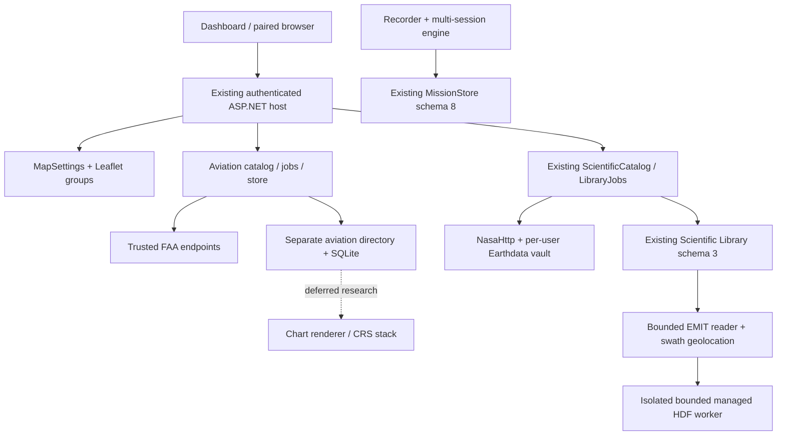

# v0.6.0 architecture

## Verified v0.5.0 baseline

**Current forward integration:** frozen main `27e5f537e45fbae90aee7d0cfca499d40bce3e4a`
(PRs #17–#19) is merged forward into the existing eight-commit 0.6.0 history through an integration PR.
Version/channel becomes 0.6.0/prerelease; see [current readiness](../v0.6.0-readiness.md) and
[private identity](../v0.6.0-private-validation.md). The source audit below describes the initial
checkpoint, before this explicitly authorized forward integration; it does not override current status.

Source `2419efa22a4205fdbcc0dbe2b8f06fa07a6586b2`: .NET 10.0.402, local ASP.NET Core,
SQLite; Leaflet 1.9.4; LibTiff.NET 2.4.660, GeographicLib.NET 2.3.2, NetTopologySuite 2.6.0.
`Directory.Build.props` remains 0.5.0/prerelease until version/profile tooling is updated deliberately.
No additional native dependency has been approved or packaged.

| Existing owner / files | Reuse / extension |
|---|---|
| Engine `MapSettings`, `wwwroot/basemaps`, `map`, `dialog-ui` | OSM/Natural Earth offline, Esri public key DPAPI, trusted raster metadata, synchronized preference revisions, Leaflet groups and accessible popup lifecycle. Add compatible styles and unified layer controls here. |
| `ResearchApi`, `EngineApplication`, `AccessControl` | Register aviation services in the existing host; authenticated bounded reads; CSRF mutations; loopback-only consent/storage configuration; no arbitrary URL fetching. |
| `ScientificCatalog`, `NasaCatalog`, `ScientificLibraryJobs`, `ScienceLibraryJobsStore`, `NasaLibraryJobs` | Existing exact-selection/hash approval, Library schema 3, durable jobs, checkpoints/reuse, numeric validation and one-writer policy. EMIT extends this path, not an alternative NASA queue. |
| `NasaHttp`, `EarthdataCredentials`, `NasaGuidedImport`, `HyperspectralImport` | Strict original/redirect allow-lists, per-user OS-vault token; Classic/NG original ENVI verification remains intact. LP DAAC redirects require independent validation before extending ORNL-only direct access. |
| `ScientificRaster`, `RemoteScienceStore`, shared `RemoteSensingModels` | Existing numeric affine raster/ENVI reader and immutable originals/manifests. EMIT swaths need an explicit non-affine geolocation contract; chart color rasters must bypass scientific numeric bands. |
| `AutomaticScientificData`, `ScientificGeographicWork`, Engine preparation/Library workers | Existing bounded transfers, quotas, flight priority, progressive scope/reuse and geographic work. Aviation shares reviewed transfer primitives, not scientific source IDs, QA/yield or budget. |
| `GeographicCollectionEngine`, MissionCoordinator/research evidence | No replacement of collection triggers, continuity/idempotency, frozen mission obligations, grading or recorder locks. |
| `library-download`, `scientific-library`, `download-activity`, `science-map`, `science-layers` | Reuse geographic selectors, actual job progress, human storage summaries and scientific measurement filters. FAA references remain a separate layer category. |

## Additive boundaries and contracts

### Secure HDF reader foundation (EMIT 1A)

`ScientificHdfReader` is an internal asynchronous Engine capability; it exposes no browser import or
arbitrary-file API. The current trusted companion/Engine/TestHost executable starts a dedicated mode
before host, database, UI and recorder initialization. One child at a time runs below normal priority;
only selected OS/runtime environment variables cross the boundary. Cancellation, protocol overflow,
parent exit and phase deadlines terminate the worker. Unsupported OS isolation fails closed.
No MissionStore, Library or aviation schema migration is needed.

The managed `AeroScience.Hdf.SafeRead` reader boundary pins 275 PureHDF 2.2.0 source files at
`c2cea464ad2a6649258ab14c8d798cb6239b9e1e`, six reviewed patches and original MIT/BSD notices. Every
compile verifies pins. Historical four-patch research evidence is preserved. Receipt
`productionApproved:false` means no NASA importer/scientific approval is asserted; the separate
assembly policy marker 2 selects the reviewed foundation. External and symbolic links fail **before
resolution**; external raw and virtual layouts fail before reading. Only deflate/shuffle/Fletcher32
filters are accepted, with strict expanded-byte checks (including a bounded intermediate checksum).

Windows uses a one-process Job Object with 256 MiB private-commit limit; Linux uses 256 MiB
RLIMIT_DATA, 4 GiB address-space cap and disabled core dumps. Managed heap is limited to 128 MiB
at startup. These are parser resource controls, not an OS privilege sandbox or Library capacity cap.
Requests are at most 64 KiB/16 operations/rank 1–4; input reads total at most 32 MiB, each decoded
chunk and total returned numeric bytes at most 4 MiB, response frames at most 8 MiB. Metadata has
bounded explicit attribute names, primitive/fixed-string values and dimensions. Unsupported types
remain Unsupported and missing fields Missing. Vlen strings, compound/custom numeric layouts and
unsupported filters do not receive guessed values. Full-width integers/IEEE floats validate physical
layouts and preserve original bits, including endian order, NaN and fill values.

Only strict source-relative paths under the matching configured Library's `Sources`/`Downloads`
ownership boundary are accepted; linked paths and oversized/changed Library identity are rejected.
An approved original length and SHA-256 are required, streamed and rechecked before releasing any
result; originals remain read-only. The current per-file 64 GiB processing ceiling and 300-second
hash deadlines are explicit operational limits. HDF parsing itself has a 15-second deadline; bulk
multi-GB product workflows must batch bounded windows without weakening these checks. This does not
interpret NASA metadata, units, QA, uncertainty or GLT, create sources, import scenes or award yield.
Authentic EMIT semantics and genuine original acceptance remain 1B–1D.

Aviation catalog records use contract version, official provider/product/edition, effective interval
(UTC only when authoritative), original link/name/bytes/hash, geometry/CRS/neatline verification status,
retrieval/as-of/expiry and attribution. Null is Unknown, not zero/unlimited. TFR notice/segment identity,
activation/altitude datum and geometry provenance are separate fields; a list summary is never a polygon.
Bounded queries require valid geographic bounds and maximum page/vertex counts; unsupported dateline
or polar queries fail explicitly until split geometry is supported. NTS owns geometry validation/indexing.

Aviation metadata/catalog and future jobs live in an independent aviation store with its own identity,
schema, byte accounting and consent. Initial local metadata does not migrate MissionStore (8) or science
(3). No fallback empty store on an unavailable configured disk. Future migrations use verified WAL-aware
backup, integrity checks and rollback. Durable jobs bind exact content and approval/budgets; never signed
URLs. Reuse existing transfer safety primitives before wiring chart originals, with a separate visible
aviation allowance. User close is not job cancellation; completed originals require deliberate deletion.

EMIT pairing records retain separate collection/version/scene and companion identities, original hashes,
time, variables/dimensions/units, fill/QA meanings and wavelength/FWHM vectors. Reading returns native
swath indices plus documented location/GLT evidence, not a fabricated affine grid. GLT valid entries are
one-based; zero/non-geolocated entries are not observed pixels. Window/chunk reads and cancellation
must bound memory independent of cube size. Derived geographic views/cache are labeled regenerable;
original values, masks and uncertainty remain authoritative. No radiance-to-reflectance relabeling.

## Source gates and failure behavior

Chart rendering is **deferred by owner**: ordinary inventory returns retained metadata with explicit
deferred status, and ordinary tile requests return 410. The normal UI neither loads the renderer nor
requests interior tiles. Default packaging has no chart-native runtime; the explicit research-only
private option and manual prototype workflow are retained. No original is deleted. Existing research:
`AviationChartRaster` is a separate color-only C-ABI boundary in Missions;
`AviationCharts` projects retained approved jobs, source-specific reviewed interior definitions,
bounded authenticated PNG endpoints and checksummed regenerable caches. GDAL owns CRS/warping;
scientific `RasterGrid`/ENVI readers are unchanged. A verified optional runtime lives beside only
the applicable companion; private packaging verifies its full data/notice/hash inventory. Shared
native checks compile the exact application source, not an independently copied implementation.
One renderer/32-MiB native cache, 16-MiB warp target, sixteen queued requests, 256-pixel tiles and an
eight-second per-tile deadline keep it out of mission/telemetry locks. Initial source hashing yields
to active flight; warmed sources hold read-only identity. Full publisher neatline, edition/inset and
printed-control acceptance remains required; interior clips are explicitly a partial implementation.
No mission/science schema or acquisition budget is repurposed. New chart contracts are additive.

The [evidence ledger](../research/v0.6.0-source-feasibility.json) records actual downloads and failures.
FAA main-body neatlines/control points, Windows chart rendering and native codec distribution remain
unverified. Public FAA catalog links establish editions, not complete geographic footprints. Current TFR
list has no geometry or exact UTC activation; attempted old save_pages HTML/XML returned 404. Provide
notice/list-only behavior until an authoritative supported geometry feed is proven.

NASA official release and CMR confirm EMITL2ARFL 002 / EMITL2AMASK 003. NASA reference code uses
`location`, `sensor_band_parameters`, `glt_x`, `glt_y`, wavelength/mask metadata. This is not a substitute
for protected originals or cross-version numeric verification. No Earthdata credentials are configured
in this environment. Prefer a shared GDAL/PROJ/NetCDF/HDF stack only after license/architecture and
Windows self-contained prototype checks. Python rasterio/GDAL is an independent research tool here,
not a packaged application dependency. Do not implement ad-hoc Lambert projection or fake NetCDF.

Network outages retain last successful snapshots with separate last-attempt/error; unsearched/stale is
not current availability. Host owns refreshes; iPads read host snapshots. Refresh/download work never
runs under telemetry locks. Offline map and existing science remain usable if aviation/native codec fails.

At the initial audit, release-engineering PR #17 (`41e6da1`) was unmerged. Its now-reviewed corrections
are included by the explicit forward integration above. Historical 0.5.0 evidence keeps its original
version/source identity; it is not relabeled as current 0.6.0 validation. All release gates remain intact.

### P00 follow-up source research

The official TFR client uses GeoServer WFS `TFR:V_TFR_LOC` (1.1.0, EPSG:3857). A bounded three-feature
query and DescribeFeatureType succeeded. NOTAM_KEY identities/titles joined the official list; independent
inverse Mercator versus PROJ agreed within 2.85e-14 degrees. This is a candidate feed, not a stable external
API/SLA or full NOTAM/altitude/schedule validation. `noShapeTfrList` returned 15 notices without geometry.
Do not use the FAA client's `maxFeatures=300` assumption as a completeness guarantee. The implemented
UI remains explicitly notice-only; source evidence is retained for P05.

A single NASR diagnostic Range GET after the initial 503 succeeded. The complete 3,560,838-byte official
October 1 FIX ZIP was then acquired: 70,129 FIX_BASE rows, consistent cycle, no missing coordinate fields;
DMS/declared-decimal discrepancies <=8.89e-9 degrees. Massachusetts/California records establish distinct
real examples. Datum is not inferred from column names; official datum and broader NASR/airspace imports
still need verification. Separate FAA TIFF/world-file affine interpretation agreed within 4.97e-11 native
units, which is not a printed-chart control-point/neatline acceptance pass.

NuGet metadata identifies MaxRev.Gdal.Core and WindowsRuntime.Minimal 3.13.3.583 as candidates, with
MIT package declarations. That does not approve their bundled native dependency licenses, driver support,
ABI or Windows distribution. No package was added. The locked Windows GIS/NetCDF prototype remains a gate.

### SAA interpretation versioning (implemented continuation)

Aviation schema 5 preserves the schema-4 dataset IDs, payloads, jobs and geometry, removes only the
one-derived-dataset-per-job uniqueness constraint, and adds a nonunique job lookup. Migration is
transactional and preceded by an identity/integrity-verified WAL-aware backup. Reimported SAA adapter-2
results use a distinct immutable dataset identity; existing Class adapter-1 identity is unchanged.
Literal coordinates remain literal. Standalone full-circle boundaries use the existing WGS84 geodesic
owner with explicitly labeled rendered-vertex interpolation; original XML/units/radius remain authoritative.
Partial arcs, composite vertical operations and contributor relationships are still unsupported, never
flattened. All mission/science schemas, budgets, original observations and grading remain unchanged.
