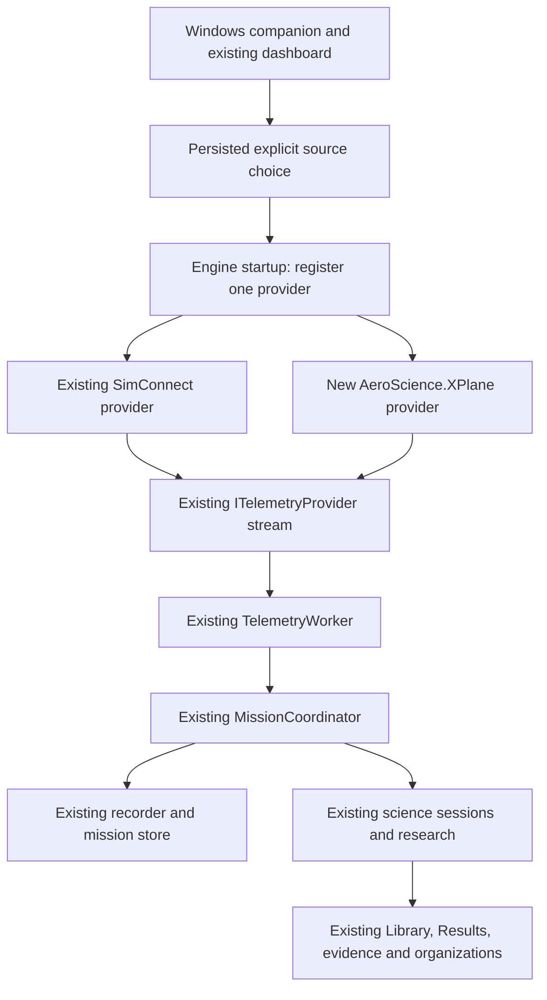

# v0.8.1 — Multi-simulator architecture proposal

P01 only; baseline `main` **`b469bce83879feb07b4abbc34801fd0fbc531cc4`**, reviewed 2026-11-25. No runtime changes or migrations implement this document. [Scope](v0.8.1-scope.md), [official API/dataref research](../research/v0.8.1-xplane-feasibility.md), [checkpoint plan](v0.8.1-implementation-plan.md).

**P02 implementation follow-up (2026-11-25):** this document retains the P01 audit/proposal. The separate [P02 handoff](v0.8.1-p02-handoff.md) records the implemented candidate provider, additive optional init properties (preserving positional constructors), v1/legacy/v2 fixture support, 500 ms core / 2 s confirmation defaults, independent field timing, watchdog and epoch barriers. Aircraft description is conservatively required in P02 rather than replaced with an unknown identity. No production registration, recorder/science exposure, origin persistence or migration implements the later integration proposals below.

## Existing architecture audit

| Question / existing component | Observed behavior and consequence |
|---|---|
| Provider seam: [Providers.cs](../../src/AeroScience.Telemetry/Providers.cs) | `ITelemetryProvider.ReadAsync(CancellationToken)` already streams `TelemetryUpdate`. Keep this interface; no second recorder or science pipeline is necessary. |
| Native acquisition: [SimConnectTelemetryProvider](../../src/AeroScience.SimConnect/SimConnectTelemetryProvider.cs) | Windows x64 native session; serialized 50 ms poll, SDK aircraft/auxiliary definitions, start/stop/pause/load notifications, reconnect after 5 s. Decodes host receipt UTC, explicit unknown aircraft, nullable AGL/Mach, normalized heading and inverted SDK pitch/bank. Reports waiting after 8 s without a frame. X-Plane must not reuse its native units/sign conversions blindly. |
| Auxiliary decoding: [ResearchTelemetry](../../src/AeroScience.SimConnect/ResearchTelemetry.cs), [EnvironmentalTelemetry](../../src/AeroScience.SimConnect/EnvironmentalTelemetry.cs) | Independent optional atmospheric/guidance/scalar packets and explicit invalid/unavailable/paused states. These native definitions are MSFS-specific; reuse their normalized shared result types, not their SimVar requests. |
| Ingress: [TelemetryWorker](../../src/AeroScience.Engine/TelemetryWorker.cs) | Applies updates through one `MissionCoordinator`; logs state/message transitions. Cancellation/end always calls `Interrupt()`. Hot-swapping this worker would interrupt a recording. |
| Orchestration: [MissionCoordinator](../../src/AeroScience.Missions/MissionCoordinator.cs) | One lock serializes commands, recording, collection and maintenance. Non-connected updates clear the current pose; **Connected + null frame preserves it for auxiliary-only updates**. A missing/stale core snapshot must therefore issue an appropriate non-connected status, not just null under Connected. |
| Recording/cadence: same coordinator | Host-UTC sampling slots, no duplicate/backward timestamp append; pause skips recording, gaps counted rather than backfilled. Start requires fresh, unpaused data (6 s) in production. Existing legacy versus armed start policies remain; simulator selection must call neither Start nor science controls. |
| Loss/change/shutdown: coordinator + [MissionStore](../../src/AeroScience.Missions/MissionStore.cs) | Transport loss does not end the recording; same-mission reconnect resumes and records gaps. Aircraft change is logged but does not automatically end the flight or create a new origin. Worker shutdown interrupts at last committed sample; startup `RecoverInterrupted()` preserves completed flights/samples. No explicit simulator-switch or universal teleport barrier currently exists. |
| Auxiliary cache: [EnvironmentTelemetryCache](../../src/AeroScience.Missions/EnvironmentTelemetryCache.cs) | Clears on disconnect, pause, aircraft change and backward aircraft timestamps. Enrichment uses at most 3 s old auxiliary receipts, but constructs `EnvironmentFrame` with its default MSFS source. Preserve freshness and make the new source explicit. |
| Models: [Models.cs](../../src/AeroScience.Shared/Models.cs), [ResearchModels.cs](../../src/AeroScience.Shared/ResearchModels.cs), [MissionScienceModels.cs](../../src/AeroScience.Shared/MissionScienceModels.cs) | `TelemetrySource` is only Simulated/Simulator; Mission and frame have no simulator/version identity. Core numeric frame fields are non-nullable. `IsValid` requires finite core values, range-valid lat/lon, UTC offset zero and nonempty aircraft; AGL/Mach/auxiliaries are optional. Guidance/environment defaults say MSFS. |
| Shared science: [ResearchOperations](../../src/AeroScience.Missions/ResearchOperations.cs), [ScienceCollectionController](../../src/AeroScience.Missions/ScienceCollectionController.cs) | Reusable independent sessions, sampling/intents, source quality, revision/session/receipt checks. `ResearchOperations` explicitly writes MSFS/SimConnect observation-source strings; this must change for **new** X-Plane observations before enabling science. |
| Dataset provenance: [ScienceCatalog](../../src/AeroScience.Missions/ScienceCatalog.cs), [ScienceStore](../../src/AeroScience.Missions/ScienceStore.cs) | Four atmospheric definitions contain MSFS/SimVar labels. Frozen dataset `ProvenanceJson` says SimConnect packet receipt and includes instrument/configuration/plan. A provider alone would mislabel X-Plane science. Do not globally edit frozen historical definitions/hashes. |
| Geometry/results: [SensorGeometry](../../src/AeroScience.Missions/SensorGeometry.cs), [TerrainProfiles](../../src/AeroScience.Missions/TerrainProfiles.cs), [ResearchExports](../../src/AeroScience.Missions/ResearchExports.cs) | Geometry expects nose-up pitch, right-wing-down bank, true heading, qualified AGL and separately unverified simulator vertical reference. Algorithms are reusable; source-dependent labels and source/time context need correction. No new DEM/LiDAR engine is warranted. |
| Registration: [EngineApplication](../../src/AeroScience.Engine/EngineApplication.cs), [EngineOptions](../../src/AeroScience.Engine/EngineOptions.cs) | Hardwired SimConnect registration; validation rejects every other telemetry mode; toolbar worker registered independently. Replace with explicit one-provider registration and source-aware toolbar gating, preserving options/security validation. |
| Desktop/profile: [MainForm](../../src/AeroScience.Desktop/MainForm.cs), [ApplicationProfile](../../src/AeroScience.Engine/ApplicationProfile.cs), [StorageManager](../../src/AeroScience.Missions/StorageManager.cs) | Desktop startup hardcodes SimConnect and bridge=true; profile `EngineOptions()` does not project a simulator preference. `AppPreferences` has none. Compiled release/validation isolation is distinct from simulator selection and must stay distinct. |
| Setup/settings: [SetupWizardForm](../../src/AeroScience.Desktop/SetupWizardForm.cs), [SettingsForm](../../src/AeroScience.Desktop/SettingsForm.cs), [ToolbarWorker](../../src/AeroScience.Engine/ToolbarWorker.cs) | Setup offers toolbar install checked by default, discovers Community folders and surfaces native runtime requirements; status/update prompts assume MSFS. In X-Plane mode bypass toolbar setup/prompts/CommBus without uninstalling existing MSFS components. |
| Archives/evidence: [MissionStore](../../src/AeroScience.Missions/MissionStore.cs), [EvidenceContracts](../../src/AeroScience.Missions/EvidenceContracts.cs), [SubmissionEvidenceProtocol](../../src/AeroScience.Missions/SubmissionEvidenceProtocol.cs) | Mission schema **13**, source enum text, telemetry JSON, streaming export format 2 with host-UTC basis. Evidence contracts and submission documents are version checked and hashes are verified. Extra identity needs an explicit persisted/exported contract, not an inferred UI label or silently altered original JSON. |

## Minimal provider design

Proposed new project `src/AeroScience.XPlane/` references Shared and Telemetry only. Use .NET `HttpClient`, `ClientWebSocket`, `System.Text.Json`, cancellation and injectable clock/transport seams. No XPLM/plugin, SimConnect/native reference, external locale/network dependency, aircraft control or separate science controller.

P02 proposed files: `XPlaneTelemetryProvider.cs`, `XPlaneOptions.cs`, `XPlaneWebApiClient.cs`, `XPlaneDatarefs.cs`, `XPlaneSnapshotAssembler.cs`; tests in `tests/AeroScience.Tests/XPlane*Tests.cs` with explicitly synthetic protocol fixtures. These paths are proposals, not existing or completed components.

Keep `ReadAsync` unchanged. Add the minimum **optional trailing metadata** to existing shared DTOs in P02/P04, with null omitted in serialization:

- `SimulatorOrigin`: configured simulator ID, reported version/raw build when available, adapter ID/version, negotiated API version, connection epoch, mapping revision, capability/limitation identity and reported aircraft identity. Unknown stays null. A SimConnect DLL version is not the MSFS simulator version.
- `SimulatorSampleContext` on `TelemetryUpdate`: epoch, original source-clock components, receipt/confirmation window and quality limitations for the reconstructed snapshot. No changed enum meanings or replacement core numeric fields.
- A small capability snapshot of available qualified channels/limitations. Resolve it through the existing readiness/sensor projection; do not invent a second instrument catalog/evaluator.

Retain `TelemetrySource.Simulator` for both real simulator providers and `Simulated` exclusively for fixtures. A simulator enum member alone would break older parsing and still omit build/adapter identity. Keep original enum wire values and use explicit origin metadata instead.

### Snapshot and lifecycle contract

1. Restrict endpoint to loopback plus validated port. Probe capabilities; use advertised/common v1 or a legacy-v1 response proven to match X-Plane's registry/schema. Do not trust an unrelated service just because port 8086 accepts HTTP. Unsupported versions/403/malformed identities remain unavailable.
2. Resolve a fixed bounded list of stable names and their actual types. Numeric IDs belong to the connection epoch. Read base64 data as bounded bytes; tolerate valid trailing NULs, reject malformed encodings and unsafe/oversized text. No arbitrary plugin lookup UI or full-registry polling.
3. Subscribe using unique non-recycled request IDs. Require the matching success result **and** complete initial values, in either arrival order. Drop old-epoch acknowledgements/updates. Clear caches on reconnect/reload/aircraft change; same-process stable IDs do not imply a stable aircraft configuration.
4. Assemble deltas into the latest state. Track `lastChanged`, `lastReceived` and `lastConfirmed` separately. A constant latitude/temperature can be correct; silence is not itself a new sample. Source-clock progression and a healthy WebSocket alone do not redate all cached measurements.
5. Use bounded explicit value reads to confirm unchanged required/science channels. Initial proposed qualification budget: core confirmation age ≤2 s and a documented bounded snapshot span; atmosphere must also satisfy the existing ≤3 s position association. These are conservative implementation targets, **not measured API guarantees**. P02 tests and P06 measurements must determine a sustainable bounded refresh batch/concurrency and reject a composite that exceeds it. Preserve actual receipt times/window; do not claim atomic native packets.
6. Emit a frame only from a newly qualified source update/read group, never a free-running timer filling gaps. Missing required numeric/pause/live-eligibility inputs produce status-only Initializing/Unavailable, clearing the coordinator's old pose. Optional channels emit explicit Unavailable/Stale or remain null; they cannot make missing data valid. Do not weaken `TelemetryFrame.IsValid`, 6 s recording freshness or existing auxiliary/source checks.
7. Use host receipt UTC for existing frame timestamps; monotonic elapsed time for timeouts/age/performance. Keep simulator clocks/date/rates separate. No host-year guess, clock backfill, accelerated-time sample multiplication or timestamp repair of old rows. A freshly confirmed paused state may remain Connected/paused without an advancing flight clock; it cannot produce recording/science observations. Requalify after clock rollback/replay/load/teleport and break geometry/holds before publishing further eligible evidence.
8. Temporary transport interruption within a verified same-source flight may resume the existing recording with a real gap. A new process/flight epoch or changed aircraft cannot silently bridge scientific continuity. For X-Plane, hold/requalify science; after simulator-process restart require ending/reviewing the old recording and starting a new flight. Preserve the existing MSFS reconnect behavior; source preference never changes while recording.
9. Retry transient loss with cancellable bounded backoff (initial 1/2/5/10/30 s schedule proposed). Distinguish disabled API, loading, unsupported contract and stale data. Bound message bytes/arrays, outstanding reads, pending requests and queue size; coalesce superseded state, account for drops and never replay a backlog as fresh acquisitions. Cancel/dispose HTTP, WebSocket and timers cleanly.

Live/menu qualification and pause-clock behavior remain explicit real-simulator gates. API “connected” is not a substitute for flight eligibility; a local protocol fixture cannot establish that predicate on a genuine installation.

## Source selection and desktop experience

One Settings choice: **Microsoft Flight Simulator 2024** / **X-Plane 12**. Default missing preference to MSFS. A versioned optional `SimulatorPreferences` member on `AppPreferences` records source and advanced local port (8086 default); unknown versions/values disable live connection with recovery guidance rather than choosing a different simulator. Use original settings locks, atomic writes, validation/confinement and maintenance gate. Keep language, theme, display units, LAN, scientific consent and storage independent.

**Decision: apply source changes after explicit companion restart**, initially. Refuse saving a changed source during an active recording/maintenance; tell the pilot to finish the flight first. Do not stop/restart `TelemetryWorker` opportunistically: its `finally` interrupts the flight. After restart `ApplicationProfile.EngineOptions`, `MainForm.StartEngineAsync`, options validation and engine DI project the same persisted choice. Expose effective versus requested state honestly.

The dashboard keeps current routes/controllers/focus and displays chosen simulator, Connected/Disconnected/Unavailable plus clear loading/freshness detail. Add keys through the existing versioned bundles and English fallback; non-English resources retain their candidate/human-review status. No technical dataref configuration is needed in normal workflows. Offline history, planning, Library and source consent work when neither simulator is running.

Register the original toolbar worker/CommBus only for MSFS and when the existing bridge setting permits it. X-Plane mode skips native runtime probes, Community discovery/install prompts and toolbar update prompts; a stale or manually issued native toolbar command cannot operate an X-Plane mission. Source choice never installs/removes a toolbar. Preserve MSFS package/bootstrap/lifecycle, wire limits (1,024/8,000 bytes) and all original command/source/revision/session authorization. Both simulators may be running; only the selected provider is contacted.

Packaging may still contain authorized MSFS and LiDAR components for existing features. X-Plane-only startup must be proved on Windows without a loadable SimConnect runtime; do not remove shared native prerequisites or relax the MSFS distribution gate to achieve this.

## Identity, persistence and scientific provenance

Current generic source classification is insufficient. For new flights, freeze `SimulatorOrigin` at start, with append-only epoch/aircraft transition records. A small proposed `mission_simulator_origins` table associates mission + epoch + versioned payload/hash; add an origin reference to new export/dataset manifests. No mass update of existing telemetry JSON, mission source text, observations, source hashes or evidence payloads.

Minimum persistence belongs in **P04 before X-Plane science is enabled**. Current mission schema is 13; reserve the next available additive migration (candidate 14, recheck before implementation). New origin rows must be included in mission cleanup/backup/export ownership. Preserve existing migration verification and guarded backups; an older executable currently refuses a future schema, so upgrades cannot reuse the accepted beta's live database behind its back. P05 validates disposable legacy copies and defines the separate development/release profile and explicit upgrade/rollback boundary. No migration is executed in P01.

Historical `Simulator` records lacking origin remain readable and explicitly **legacy simulator / version unknown**. Do not retroactively certify MSFS version/adapter from branch history, UI defaults or SDK DLL metadata. Historical source strings and dataset snapshots retain their actual recorded meaning.

Before enabling new science:

- Resolve new observation `Source` and instrument/dataset source descriptions from the selected provider's channel mapping, instead of the current hardcoded MSFS strings/SimVars. Keep stable measurement/instrument IDs, numeric units, calibration rules and existing original-data hashes. Freeze new definitions per dataset; do not rewrite old hashed definitions.
- Carry actual environment/guidance source through `EnvironmentTelemetryCache` and DTO construction. Existing `EnvironmentReading` has no per-reading derived provenance: leave unmatched channels unavailable until a versioned representation can distinguish derivations. In particular, MSL−AGL is not a reported ground-altitude scalar.
- Add origin and timestamp-basis data to new evidence/export envelopes through an explicit versioned extension. [EvidenceContracts](../../src/AeroScience.Missions/EvidenceContracts.cs) currently accepts version 1; [SubmissionEvidenceProtocol](../../src/AeroScience.Missions/SubmissionEvidenceProtocol.cs) validates supported document versions, exact item hashes and original telemetry. Preserve old readers/verifiers and input bytes. New origin-bearing evidence must be verified by a capable server or refused with a clear unsupported-version state; never silently strip identity or claim older-server compatibility without tests.
- Keep original observations, modeled corridor, genuine source-backed DEM/DSM and historical LiDAR as distinct types. External sources retain project/date/CRS/datum/QA/coordinate/hash provenance; a simulator choice cannot alter them or add original acquisition/card/campaign credit.

These are narrow integration changes to existing stores/validators. No new collaboration service, cloud location history, scientific reconstruction algorithm or replacement recorder is proposed.

## Scientific capability audit

**Shared** means architecture reuse, not an X-Plane acceptance pass. Multiple categories may apply: the row lists the first gate and specific limits.

| Workflow | Category | Reuse / qualification |
|---|---|---|
| Offline plans, saved/custom missions, templates, routes, waypoint/survey patterns | Supported by shared architecture | Existing planners/controllers and frozen revisions; simulator-specific navigation export such as MSFS PLN is not X-Plane FMS import support. |
| Flight recording and archived track/analysis | Requires X-Plane validation | Same coordinator/store/sampling and replay of saved data; validate core pose, UTC, pause/gaps. No API writes to replay/control X-Plane. |
| Independent sessions/automation | Supported by shared architecture | Original `ScienceCollectionController`, command identity/revision, explicit actions and trigger rules; validate fresh source eligibility. |
| Four ambient instruments | Requires implementation changes | Existing calculations/units/calibration can remain; new channel source descriptors/dataset provenance required, then genuine temperature/pressure/wind/density checks. |
| Universal / Realistic modes | Requires X-Plane validation | Existing assessments and frozen rubric; Universal is not permission to fabricate channels. Calibrations remain separate derivations. |
| Cards, attempts, holds, review/waivers | Requires X-Plane validation | Existing focus/activation/evaluation/permission semantics; requalify temporal/source/aircraft/guidance evidence, never give continuity credit across gaps/time acceleration without validated policy. |
| Flight guidance | Requires X-Plane validation | Engagement candidate exists; detailed lateral/vertical/armed/captured mappings remain unavailable until specifically verified, including third-party aircraft. |
| Cloud-structure/environmental channels | Unsupported or deferred where unmatched | Layer coverage, windshield ratio, sea-level humidity and local vectors are not substitutes for current ambient channels. Keep original features for MSFS and explicit missing capability for X-Plane. |
| Survey assessment and scanner corridor | Requires X-Plane validation | Reuse geometry/segmentation/planning; validate attitude signs, fresh AGL, track and transitions; do not connect teleport endpoints into coverage. |
| DEM/DSM and elevation products | Supported by shared architecture | Same source-owned acquisition/QA/datum/processing; simulator-derived intersection still requires pose validation. No new datum transforms. |
| Historical LiDAR, LAS/LAZ/EPT and renderer | Shared processing; source-label integration required | Reuse pinned native reader, bounds/source consent/provenance/fallback tables; new-output notices in `LidarProcessing.cs` must not hardcode an MSFS aircraft when X-Plane supplied the pose. Historical points are not aircraft-collected returns. Existing indexed COPC/unsupported transforms remain unsupported. |
| Satellite/remote-sensing products | Supported by shared architecture | Same genuine retained source/provider/date/grid/mask and bounded downloads; no new airborne image capture claim. |
| Source acquisition/reuse and download status | Supported by shared architecture | Reuse original local-first workers, permissions/budgets and measured progress; coordinate existing [#33](https://github.com/JustSeanC/AeroScience/issues/33), not a second downloader. |
| Results and exports | Requires implementation changes | Preserve numerical/scientific products and source ownership; update new source/clock labels and versioned origin envelope. |
| Organizations/submissions/review | Requires implementation changes | Reuse existing claims, preparation, grants, queues and server decisions; qualify new evidence identity versions/eligibility without optimistic approval. |
| Optional organization live monitoring | Requires X-Plane validation | Reuse one ephemeral consented stream; no auto-sharing on source choice/connect/record/science, no persistent track/replay added. |
| Calibration/storage/privacy/deletion | Supported by shared architecture | Original definitions, quality, protected ownership and explicit operations; add origin-table cleanup tests and never change originals to satisfy compatibility. |
| MSFS toolbar | Supported by existing MSFS architecture only | Preserve current integration; intentionally unavailable as an X-Plane controller. |
| X-Plane plugin/panel, controls, v0.9 mission families | Unsupported or deferred | Explicitly out of v0.8.1 scope. |

## Security, performance and regression boundaries

The read-only client allowlist is GET capability/discovery/value requests and WebSocket subscribe/unsubscribe; no dataref-set, command or flight messages. Reject redirects/proxies/remote hosts, oversized/unexpected responses, invalid IDs/types and stale epochs. A local API has no documented read-only authentication scope; do not describe it as cryptographically authenticated or change X-Plane's network policy. Existing dashboard Host/origin/session/CSRF and organization trust/expiry/role checks remain independent.

Any eventual simulator-settings API must enforce local desktop-owner/loopback control, validated settings and existing CSRF rules. Paired dashboard and organization viewers may display the selected source but must not gain a host-source-change permission from pairing or membership.

Do not log raw frames, registration/path/location traces, response bodies or credentials by default. Use stable status codes, bounded counters, redacted optional diagnostics and user review before external sharing. Bounded caches/queues and cancellation must be tested under slow consumers and long flights. Set numerical performance budgets from P02/P06 measurements; no unmeasured “negligible overhead” claim.

Reusable tests include [MissionTests](../../tests/AeroScience.Tests/MissionTests.cs), [ResearchTests](../../tests/AeroScience.Tests/ResearchTests.cs), [MissionScienceTests](../../tests/AeroScience.Tests/MissionScienceTests.cs), [MissionEvidenceStoreTests](../../tests/AeroScience.Tests/MissionEvidenceStoreTests.cs), [TerrainSurveyGeometryTests](../../tests/AeroScience.Tests/TerrainSurveyGeometryTests.cs), [SensorOperatingIntegrationTests](../../tests/AeroScience.Tests/SensorOperatingIntegrationTests.cs), [StorageTests](../../tests/AeroScience.Tests/StorageTests.cs), [ExternalSourceDeletionTests](../../tests/AeroScience.Tests/ExternalSourceDeletionTests.cs), [OrganizationSubmissionTests](../../tests/AeroScience.Tests/OrganizationSubmissionTests.cs) and [OrganizationLiveTests](../../tests/AeroScience.Tests/OrganizationLiveTests.cs). Keep their original assertions and add provider cases; fixture success never becomes installed simulator acceptance.
