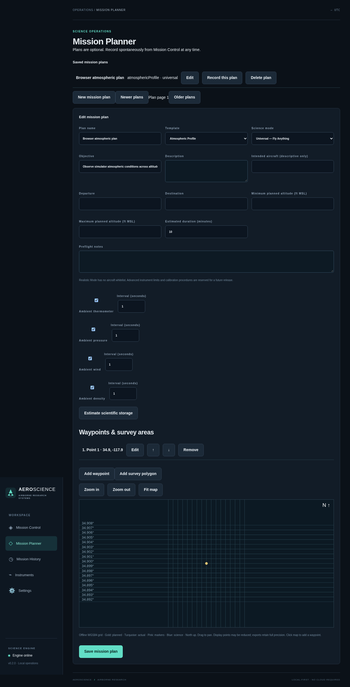
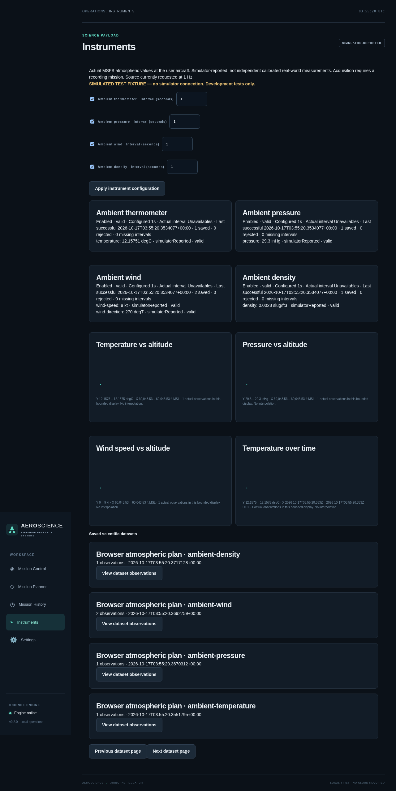
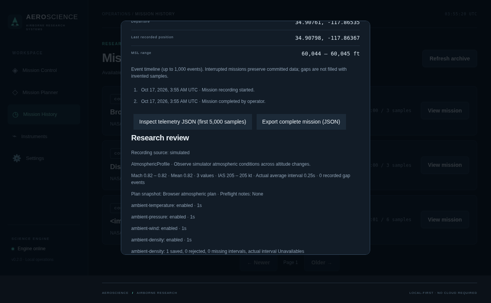

# v0.2.0 implementation report

## Scope and stages

The source implements Science Mission Operations on the existing architecture, including the previously planned v0.1.2 changes. There is no separate v0.1.2 release. It retains one Windows entry point, the native SDK toolbar, local-first storage, Universal/Realistic modes, nullable actual Mach and the original 1 Hz cadence investigation.

1. **Baseline / UI:** preserved native bootstrap and corrected CommBus/core ABI contracts; updated mission wording and Mach labels; removed only the toolbar scroll-container outline while retaining control focus and the single responsive interface.
2. **Planning:** saved CRUD plans, four editable templates, optional operational fields, waypoint editing/order, survey polygons, preflight notes and immutable recording snapshots; spontaneous recording remains available. Optional automatic active-flight-plan import is not offered: the documented file-path state does not establish a universally readable route for streamed/custom plans.
3. **Scientific instruments:** a modular four-instrument atmospheric catalog, independent enable/interval controls, real SimConnect auxiliary definitions, per-reading provenance/units/quality and persistent counts/cadence/errors. Missing channels are not synthesized. The live reception of the new variables still requires MSFS testing.
4. **Geographic operations / guidance:** local WGS84 grid/map with pan/zoom, plans/actual tracks/current heading/markers/scientific positions; bounded display and incremental live queries; actual standard AP/mode/selected-target readouts, deduplicated changes and unavailable/ambiguous states. No simulator writes.
5. **Data and analysis:** independent scientific SQLite store, stable portable dataset references, verified old-schema backups, safe dual-storage migration, native independent typed clears/backups/rollback, science-only capacity estimates, historical review, full streamed JSON/CSV/GPX/KML/text report.
6. **Release preparation:** version 0.2.0 and primary installer name updated; prerelease policy explicit despite no `-alpha` filename suffix; genuine SDK/runtime/Inno checks and manual Windows publication retained. New science/archive/data-management acceptance groups were added. No cloud-built official SDK package or installer is claimed.

## Evidence and technical details

| Area | Implementation / evidence |
| --- | --- |
| Plan persistence | `mission_plans` independent of recordings; transactionally stored `mission_research` snapshots; edit/delete/restart/history tests |
| Atmospheric variables | AMBIENT TEMPERATURE/Celsius, PRESSURE/inHg, WIND VELOCITY/knots, WIND DIRECTION/degrees true, DENSITY/slugs per cubic feet; [official SDK research](sdk-research-v0.2.0.md) |
| Instrument/provenance architecture | Definitions/configuration/runtime state plus independent observations; SimulatorReported/Derived/InstrumentModeled distinguished; this release emits no modeled scientific substitute |
| Maps | Fully offline WGS84 grid; precise DB coordinates, bounded display, sequence cursors, dateline handling; no tile account/network/basemap requirement |
| Guidance | 31 separate FLOAT64s; explicit AP/active/armed flags and selected slots; conflicting/custom data unavailable; no inference from aircraft motion/targets |
| Mach / native ABI | Core remains 360 bytes with Mach at 352, payload offset 40; auxiliary atmosphere 40 bytes and guidance 248; CommBus DWORD offsets unchanged |
| Independent clearing | Native Windows UI only, scope preview/counts/size, typed phrase plus confirmation, active guard, stopped services/exclusive leases, verified backup, transactional rollback, derived/reconciled dataset availability |
| Estimates | Actual channel count × ceil(duration/interval), serialized-row/key/index allocation with 2× margin, SQLite pages, free capacity and 64 MiB reserve; science only, explicitly approximate |
| Reports / exports | SQL-derived summaries; complete streamed versioned JSON, explicit-unit flight/science/events CSV, correct GPX/KML coordinate/altitude/time conventions, full notes/markers in text report |
| Historical migration | Verified schema-2/schema-3 backup tests, unchanged legacy telemetry/null Mach/modes, populated library move with stable refs/originals, missing-store no-replacement tests |

See [science operations](science-operations.md) for limits and [architecture](architecture.md) for component boundaries. Code retains a separate science stream/database rather than changing the proven flight data definition. The scientific database is created only for actual acquisition/storage initialization, not fabricated demonstration products. Test-only providers never ship.

## Validation status

The exact measured cloud results and artifact locations are recorded in [validation results](validation-results.md). They cover source builds, managed/native-layout decoding, APIs/security, planning/acquisition, independent storage/deletion, large exports, browser workflows/responsiveness and crash recovery. Screenshots are labeled **browser test fixtures**, not live MSFS evidence. Current results are **72 .NET**, **49 helper** and **14 browser** tests passed, with no failures/skips; the actual-process recovery smoke and 440-file Windows x64 cross-publish validation also pass.

The user previously reported v0.1.1 installation/live recording/history/offline export, upgrade and uninstall/reinstall preservation passed. The finalized prior source was `e1a29f2873f19df57894c8ac34098cc88bea7bda`, installer SHA-256 `f7d214aa209efeb566812bb085e01a0aeaa3c3ae8673e5595723930d0a0956ab`. Earlier native drag/resize and CommBus exchange were also user-observed. These are historical user-reported checks, not automated cloud verification and **not v0.2.0 passes**. The earlier public asset's availability was not independently established here.

## Remaining acceptance / release blockers

- Build the changed auxiliary ABI contract/full toolbar with the **actual installed official MSFS 2024 SDK**, recheck native runtime loading/exports, and compile the new Inno installer on Windows.
- Run the exact new installer: clean installation/first run, upgrade from backed-up v0.1.1 stores, toolbar install/update/skip, native clearing/backups, uninstall/reinstall and data preservation. WinForms cross-compilation cannot verify these interactions.
- Receive and compare actual atmosphere, AP/guidance/selected targets and Mach in MSFS; test different aircraft, stale/pause/reconnect behavior and sustained actual sampling/performance. Standard/custom avionics limitations require real evidence.
- Retest native toolbar header/edge behavior and absence of the container border. Test physical Quest 3 performance and iPad Safari separately; browser viewports are not device acceptance.
- Finalize the exact accepted setup bytes, then upload the setup/checksum/evidence to a **v0.2.0 GitHub prerelease**. No new binary release/tag/publication is performed as a substitute for Windows acceptance.

The intended primary final path is `C:\AeroScience-Builds\Science020-1\AeroScience-Setup-v0.2.0.exe`, **after** the documented Windows build and finalization succeed. Its checksum does not exist from source work alone. Follow [exact Windows instructions](public-release-windows.md) and [live test sequence](v0.2.0-windows-testing.md).

## Deliberate boundaries

No rigid aircraft whitelist, advanced instrument calibration/limits, mission scoring/compliance evaluation, named instrument preset library, camera/remote sensing, mandatory cloud/account, autopilot controls or full replay was added. Templates/planned-vs-actual overlays are functional now; v0.2.1 scoring/presets, later remote sensing and replay remain future scope. The offline map is a coordinate grid, not imagery. Automatic active MSFS plan import is investigated but unavailable. Standard guidance cannot decode proprietary custom FMA modes without a documented interface. These limits are explicit in the UI/docs rather than represented by fake working controls.

## Screenshots (test fixtures only)

These show the implemented interfaces using synthetic automated-test sources. They are not MSFS/device acceptance and contain no user mission data.

