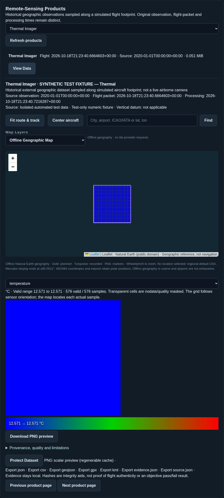
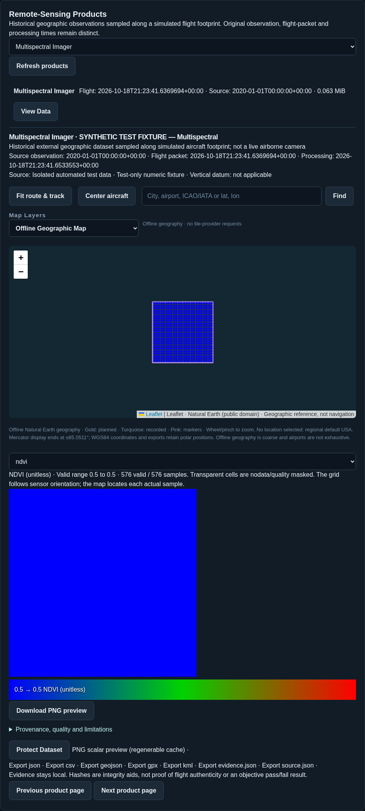
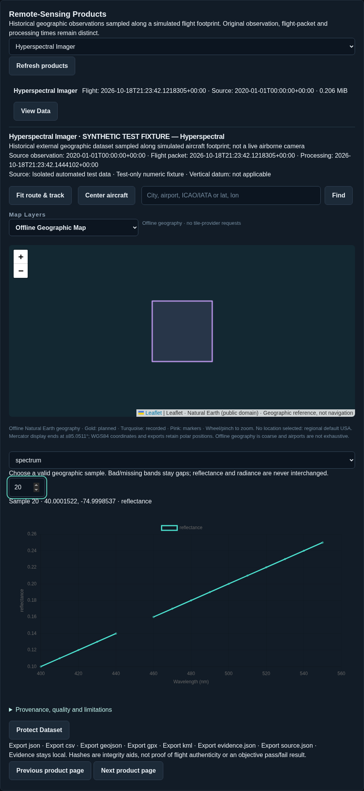
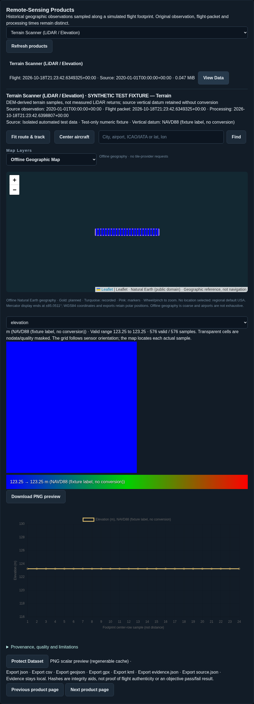
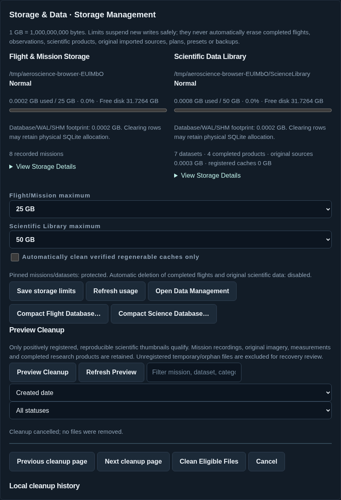

# v0.3.0 implementation and verification report

This report describes implemented source and cloud validation. It is **not a Windows/MSFS acceptance certificate** or a claim that a v0.3.0 setup EXE has been built/published here. Exact build/manual-publication steps: [Windows guide](v0.3.0-windows-testing.md).

**Release hold:** all four numeric provider workflows completed genuine-data runs, recorded in [the provider evidence](research/v0.3.0-automatic-provider-acceptance.json). The final exact-source online rerun was interrupted by a cloud HTTP tunnel failure (503 across scientific providers and GitHub). It is explicitly pending, not passed; the release build refuses distribution until fresh final-source network evidence is recorded. No v0.3.0 installer/release was published, and no hardware acceptance is inferred. The earlier successful online runs are not mocked fixtures.

1. **Implemented scope:** automatic direct public-data preparation for terrain, thermal and multispectral; genuine NASA hyperspectral discovery with advanced ENVI import; bounded asynchronous geographic sampling, source catalogue/import, persisted products/viewers/exports/evidence, new-install OSM privacy/defaults, safe storage caps/cleanup/protection, optional GitHub update notifications and one-command automatic technical alpha finalization. Existing atmospheric/planning/recording/native controls remain.
2. **Research:** official USGS Landsat C2 ST scaling/quality documentation, Copernicus Sentinel-2 L2A product/quality guidance, NASA AVIRIS/AVIRIS-NG/EMIT access/formats, USGS 3DEP, OSMF tile policy, existing official MSFS SimVar/ABI/CommBus work, managed LibTiff package/license. [Sources guide](remote-sensing/sources.md) links authoritative producers. No account/shared key or reference archive is bundled.
3. **Simulator values actually used:** existing TITLE, PLANE LATITUDE/LONGITUDE, PLANE ALTITUDE/ALT ABOVE GROUND, AIRSPEED INDICATED/TRUE/MACH, GROUND VELOCITY, true heading/track, PLANE PITCH/BANK and vertical speed. Existing atmospheric temperature/pressure/wind/density and read-only guidance remain. Shared pitch/bank already normalize SDK signs. No native packet-layout/SimConnect ABI definition changed for remote sensing. Missing values stay missing; host receipt UTC is not claimed to be the simulator's flight clock.
4. **Exact real-data workflows:** classic GeoTIFF Landsat ST_B10+QA_PIXEL (+QA_RADSAT), Sentinel B02/B03/B04/B08+SCL, real ENVI ≥16-channel radiance/reflectance and one-band metre DEM. Automatic numeric 3DEP, GLO-30, Landsat and Sentinel paths generate internal manifests and use bounded native-grid preparation. Supported WGS84 geographic/UTM, numeric types and bounds are in the [provider guide](remote-sensing/automatic-data.md). No direct EMIT NetCDF, JP2, BigTIFF or LAS/LAZ support.
5. **Coverage/resolution/clocks:** limited to valid automatically prepared or advanced imported scenes; each band keeps its own native grid/resolution/date. Source observation/publication, flight packet and processing timestamps are separate. 24×24 nearest-source samples do not improve source resolution or imply simultaneous/live imagery. Unknown composite dates stay unknown.
6. **Thermal demonstration:** real STAC discovery selected LC08_L2SP_014032_20240903_02_T1. Automatic native ST_B10/QA_PIXEL/QA_RADSAT acquisition, generated metadata, verified import and 576 QA-screened derived samples passed; a production mission product was saved/reloaded with explicitly synthetic flight positions. Independent GDAL reads matched all compared temperature/QA samples exactly. Synthetic DN40000 regressions are separate; actual MSFS flight QA remains pending.
7. **Multispectral demonstration:** real Earth Search scene S2A_18TWK_20240903_0_L2A was automatically cropped from native B02/B03/B04/B08/SCL COGs and imported, with actual 0.0001 scale / −0.1 reflectance offset and unscaled SCL. 183 valid NDVI samples out of 576 checked positions and a production saved/reloaded product passed. All compared source bands matched independent GDAL reads exactly. Negative source reflectance remains preserved; invalid NDVI stays null and does not discard otherwise valid reflectance. Actual MSFS collection remains pending.
8. **Hyperspectral discovery/limitation:** real NASA collection/granule metadata research confirms protected multi-GB EMIT NetCDF and AVIRIS/AVIRIS-NG binary/header distributions. Automatic CMR geographic discovery for three actual catalogs is implemented; a final network rerun of that combined discovery was blocked by cloud connectivity. No protected download, credential flow or automatic spectral preparation is claimed. Advanced ENVI remains supported. **Reader regression:** decoded ENVI fixture provides 16 real file channels, actual header wavelength axis, scaled values and a bad-band gap; geographic sample chart/CSV are functional. The fixture is synthetic; genuine distributor cube preparation and gaming-PC collection remain separate acceptance.
9. **Terrain demonstration:** automatic USGS 3DEP numeric 256×256 preparation and global Copernicus GLO-30 DSM byte-range/native crop each passed real discovery, retrieval, generated metadata, import and 576 derived samples plus saved/reloaded production mission products with synthetic flight positions. A numeric pixel-boundary tie fix prevents clipping origins from changing exact-boundary samples; a gradient Point-grid regression covers it. Final independent GLO-30 rerun was interrupted by the cloud network, so no independent post-fix GLO-30 pass is claimed. Earlier investigation: the cloud investigation retrieved a real small USGS 3DEP service elevation subset (EPSG:4326, 32×32; values about 0.495…27.761 m). AeroScience imported this real subset and saved 576 DEM-derived samples (11.869517…13.173402 m) using explicitly synthetic flight geometry; an independent rasterio read at every saved sample position matched all 576 values exactly. [Reproducible result metadata](research/v0.3.0-real-dem-reader.json) preserves source/product hashes without bundling the dataset. It is genuine external elevation, not aircraft LiDAR. The test fixtures separately verify deterministic profile/products. Service resampling/native vertical-datum uncertainty must stay explicit; no MSFS flight acceptance is inferred.
10. **Integrity:** exact numeric bands, finite/nodata/QA masks, scene consistency, original scale/units/wavelengths, immutable copied file hashes, complete-product hashes, safe paths/CRS/layout validation. No fabricated science fallbacks, vegetation/mineral inference, counterfeit precision, objective pass/fail or authenticity claims.
11. **Footprints:** body-axis attitude/mount rays intersect an AGL reference plane, then WGS84 geodesic displacement; local range/tilt limits, dateline/polar handling and UTM bounds. Terrain uses a narrow swath. Off-aircraft relief/terrain intersection and vertical-datum alignment are explicitly approximate; no full terrain ray trace/coverage percentage.
12. **Science Library:** additive remote source/product/cache catalogues; copied Sources, complete Products and regenerable Cache/Thumbnails, Metadata work ledgers/recovery/cleanup logs. Product IDs, library identity and relative references remain portable. Atomic staging/flush/rename plus SQLite publication ensure partials are not complete results.
13. **Compatibility/migration:** existing flight schema/JSON/Mach and atmospheric observations preserved. Verified backup before additive remote extension. Old presets gain disabled new instruments; modes/settings preserved. Existing stopped-store SQLite migrations copy/verify new files, IDs and protections without rewriting old observations. Missing drives are errors, not fresh replacements.
14. **Capacity:** default 25 GB flight/50 GB science, custom/Unlimited/preserved old settings, separate physical free-space warnings, cached managed usage including interrupted work; shared files counted once, backups distinguished. Science caps suspend science only; flight cap stops safely with `storageLimitReached`. Pins protected; no automatic original deletion. Cleanup uses one revalidated eligibility rule, confirmation snapshot, paging/filter/grouping, results/history and cache-only automatic passes. [Storage guide](remote-sensing/storage.md) details limits and deliberate clear/backup/compaction.
15. **Browser/native:** source manager, product map/thermal/RGB/NDVI/spectrum/terrain viewers and historical exports. Toolbar remains Mission/Payload/Map, with compact payload status/product counts and independent Pause/Resume; no heavy image stream or native drag/resize replacement. Fixture screenshots are labeled in `docs/images/remote-*-browser-fixture.png` when generated by the browser suite.
16. **Updates:** semantic release/channel selection, official setup+checksum assets and official release page only, daily cache, reminder/disable/manual check, background timeout/nonblocking offline behavior; no automatic installer download/execution. Native Settings links dashboard Updates. GitHub checks disclose IP and app version, no flight uploads.
17. **Release:** default Build-Release / Build-ReleaseCandidate automatically consume actual generated .NET/browser/helper/recovery evidence, SDK/ABI/runtime/licensing/locked-asset/prerequisite/Inno checks and exact-byte receipts. No mandatory ACCEPTANCE.json/editing/questionnaire. Idempotent verified existing output; incomplete/conflicting output preserved. Public metadata says hardware `notVerified`, publication `notPublished`; optional old explicit manual acceptance remains for historical candidates only.
18. **Automated results:** **174 .NET tests, 42 browser tests, 66 helper tests passed (zero failed/skipped in these cloud runs)**; JavaScript syntax and all 28 pinned offline asset hashes passed, actual-process crash/restart preserved committed samples/modes and refused duplicate ownership, and self-contained Windows x64 cross-publish plus structural payload/help/license validation passed. Exact source changes were tested here; Windows builds generate fresh TRX/browser/helper/recovery evidence rather than using these cloud counts as acceptance. Test fixtures never count as real SDK compilation or hardware tests.
19. **Actual hardware:** no Windows GUI/SDK/MSFS, genuine live Mach/flight/remote acquisition, Quest 3 or physical iPad tests were performed in this cloud environment. Prior v0.1.1/v0.2.1 user-reported passes do not verify changed v0.3.0. Use the recommended Windows test sequence and record observations honestly without a mandatory questionnaire.
20. **Screenshots:** implemented browser interfaces are exercised with explicitly named synthetic test sources. These are UI evidence only, not real observations or simulator captures. The real-data investigation is separately identified above.
21. **Installer status:** Windows application may be cross-published for technical review; the real setup requires the gaming PC's authorized SDK and Inno Setup. Expected final path after successful build: `C:\AeroScience-Builds\Remote030-1\AeroScience-Setup-v0.3.0.exe`. No finished setup is claimed from Linux.
22. **GitHub status:** source changes can be committed/pushed independently. No v0.3.0 binary release is claimed until the maintainer builds and uploads the setup/checksum/public record, then verifies ordinary public downloads. Manual website steps are documented; no mandatory self-hosted runner.
23. **Deferred/limits:** full replay/coverage/scoring (v0.4.0), calibration/airframe operating constraints (v0.5.0), Navigraph (v0.6.0), optional organization server/campaign generation/evaluation/sync (v0.7.0), full simulator science mapping (v1.0.0); no automated hyperspectral preparation/NASA authorization, native JP2/NetCDF/HDF/BigTIFF/LAS, general-purpose GeoTIFF/LAS exporter, true laser returns, live thermal camera or automatic source datum correction. See [future-campaign design](roadmap/research-campaigns-self-hosting.md), which records all 16 required eventual self-hosting-guide deliverables and creates no server now.

## Implemented browser interfaces — synthetic fixtures only

These captures were generated by the actual browser tests against the isolated test host. Named source pixels and flight coordinates are **synthetic fixtures, not MSFS or genuine satellite captures**. The real USGS DEM check above is separate.

## Mission Planner and first-time-user correction

The [revised walkthrough](mission-planner.md) documents explicit result selection, 72,684 bundled public-domain airport facilities, temporary waypoint Save/Cancel, visual survey drawing/validation/area estimates, retained drafts, five planner sections, survey/map-based pattern centers, stale-response guards and deliberate Fit Preview. Independent cardinal/rotated geometry tests verify lawnmower/creeping-line headings, scan lengths and step distance. Semantic orbit outlines and two visible endpoint pins retain all 73 point-to-point export vertices for one revolution, with an explicit warning rather than an invented native EFB orbit.

The shared browser map has independent planned route/semantic outline/waypoint/track/survey/aircraft/marker/sample/footprint layers. Science's expandable Scientific sample locations distinguishes successful atmospheric samples from saved external-data footprints and missing coverage. Native actions claim a thread-safe gate before dispatch, focus an existing auxiliary window, preserve legitimate ownership and release after close/error. The gate concurrency/exception regression and Windows cross-compile passed; actual Windows modal focus/pickers have not been exercised here.

Seven additional Playwright scenarios cover deliberate search and smaller airports, two-point save/cancel/navigation/export, visual survey and live pattern preview, orbit/export counts, numerical polygon geometry, reordered asynchronous responses/new drafts and crossing/cancel behavior. Existing saved-plan/native toolbar browser fixtures remain passing. These tests use synthetic flight inputs; no uncoached-user or MSFS pass is inferred. Larger P2 semantic export changes, online geocoding and broad dashboard redesign remain backlog.

The final online rerun again completed genuine USGS and Landsat preparation, import, sampling and persisted/reloaded products; Sentinel then returned HTTP 503 during a bounded range request. Separate retries for Sentinel, GLO-30 and combined NASA discovery also encountered 503. Earlier genuine numeric evidence is retained and the final release hold remains active. This environmental failure is not replaced by fixtures or a manual pass flag.

The subsequent aviation/metric requirement reuses the existing ScienceUnitSettings and conversion table rather than adding a separate preference store. Planner distances, radii, spacing, area/dimensions, altitude inputs, waypoint tolerance and export route-distance previews use visible units. Canonical field values survive display rounding and repeated switches exactly; legacy custom preferences are preserved. Track spacing drives parallel pass counts, and the survey-fit action computes a bounded heading-aligned envelope with unchanged entered spacing. Approximate envelope area is explicitly not validated sensor coverage. Four additional .NET cases and three browser scenarios cover quarter-NM conversion, fitting, saved-pattern round trips, repeated profile switches, unchanged coordinates/route distance, custom preferences and tighter-spacing pass/distance updates. v0.4.0 sensor-footprint/overlap recommendations remain deferred.
